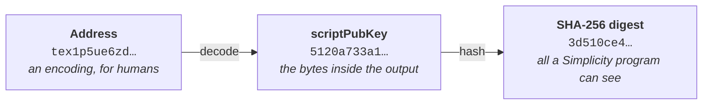

# Constraining destinations

A contract that pays someone has to be able to say whom it will pay.
The most common pattern for authorizing a spend is to require a digital
signature by a specific key. The owner of that key is often presumed to
be allowed to send assets to any address.

Other patterns constrain the recipient address somehow. A
[covenant](../glossary.md#covenant) sends assets back to itself. A
withdrawal path may be allowed to reach only one hard-coded beneficiary.
A recovery path may pay a destination fixed when the contract was
written. Each of these is a constraint on where value is allowed to go.

Simplicity has no address type. The [jets](../glossary.md#jet) that
describe an [output](../glossary.md#output) return a single 32-byte
value, and a program constrains a destination address by comparing that
value against a hash it trusts.

## Require a payment to one destination

`jet::output_script_hash(i)` returns the SHA-256 hash of the scriptPubKey of output `i`, or
`None` if there is no such output. This hash can then be compared against an expected value:

```simplicityhl,run,tx txid="0440094a1c5d16ccae819750a19b5f2e926760de112c6f88d81361c0b48f57c2" title="Output 1 must pay a specific destination"
fn main() {
    // SHA-256 of the destination's scriptPubKey, computed off-chain.
    let expected: u256 = 0x3d510ce40240546ef06a28222fd212b28df743ac812bdbd2142958ceccbc47d3;

    let actual: u256 = unwrap(jet::output_script_hash(1));
    let actual: u256 = dbg!(actual);

    assert!(jet::eq_256(expected, actual));
}
```

That runs against a real [Liquid](../glossary.md#liquid) testnet transaction, whose output 1
pays 875,121 satoshis of test Liquid bitcoin (tLBTC) to
`tex1p5ue6zd30fk23cvmpz5hj929ldld3nlvv5p5u58lnl7t8hzze8wgqjsnr3k`. Changing `expected` at all
will cause the hash of the destination address not to match, and the spend will fail.

The program doesn't learn anything else about that output. It doesn't know that the destination is a
[Taproot](../glossary.md#taproot) output, which key it pays, or which network it belongs to.

## Why the destination is a hash

An address is a human-facing encoding of exactly one scriptPubKey. It carries a network prefix,
a payload, a checksum, and on Liquid an optional blinding key. The blockchain doesn't natively
store or represent addresses. An output contains a scriptPubKey, and
a program is given a hash of that.



Only the third value is reachable from a program, and its type is `u256`: fixed width, and the
product of a one-way function. A program can therefore test a destination for equality, and
can't do anything else with it. It can't read out a public key, recover a script, discover which
kind of address was used, or learn how long the scriptPubKey was.

### What an output actually contains

An output carries an asset, an amount, a nonce, a scriptPubKey, and proofs for any blinded
amount or asset. It doesn't carry any program. For a Taproot destination the
scriptPubKey holds one tweaked key, and the script tree behind that key is chosen by whoever
eventually spends the output. It appears in that future transaction, and never appears at all
if the output is spent by key path or is never spent.

There is therefore no richer view of a destination available for a jet to return. Any detail
beyond the scriptPubKey has to be supplied by the party building the transaction.

A program can reconstruct the scriptPubKey of an output only when it already knows the program
behind it, which in practice almost always means a copy of itself. See
[a destination computed by the program](#a-destination-computed-by-the-program).

### Hashing a value that is already a hash

Some scriptPubKeys already contain a hash. A P2WPKH scriptPubKey is `0x0014` followed by
`HASH160` of a public key, and hashing it again can look circular.

The two hashes belong to different layers. The inner hash is part of the address payload:
Bitcoin hashes a key so that a lock can be short, and that hash is the destination's own
identity. The outer hash is Simplicity's view of the finished lock, turning a variable-length
script into one fixed-width value that a program can compare. Neither hash knows about the
other, and the outer one is applied to the serialized scriptPubKey bytes whatever those bytes
happen to be.

## Computing the hash off-chain

The 32 bytes a program compares against normally come from an address held by a person or a
wallet. Computing them takes two steps: decode the [address](../glossary.md#address) to its
scriptPubKey, then hash the scriptPubKey bytes with SHA-256.

Every method below must produce the following result for the address paid by output 1 of the
example transaction above. Use it as a test vector for any tool or code you adopt:

```text
address:           tex1p5ue6zd30fk23cvmpz5hj929ldld3nlvv5p5u58lnl7t8hzze8wgqjsnr3k
scriptPubKey:      5120a733a1362f4d951c3361152f22a8bf6fdb19fd8ca069ca1ff3ff967b88593b90
scriptPubKey hash: 3d510ce40240546ef06a28222fd212b28df743ac812bdbd2142958ceccbc47d3
```

A tool that prints `d347bcccce582914d2db2b81ac43f78db212d22f22286af06e544002e40c513d` instead
has reversed the bytes. See [byte order](#byte-order).

=== "hal-simplicity"

    [`hal-simplicity`](toolchain.md#hal-simplicity) decodes Liquid addresses, including
    [confidential](../glossary.md#confidential) ones, and reports the scriptPubKey in the
    `script_pub_key.hex` field. Pipe that field to a SHA-256 implementation:

    ```bash
    ADDRESS=tex1p5ue6zd30fk23cvmpz5hj929ldld3nlvv5p5u58lnl7t8hzze8wgqjsnr3k
    hal-simplicity address inspect "$ADDRESS" \
      | jq -r .script_pub_key.hex \
      | python3 -c 'import sys, hashlib; print(hashlib.sha256(bytes.fromhex(sys.stdin.read().strip())).hexdigest())'
    ```

    `python3` does the hashing because the command-line SHA-256 tool isn't named the same
    thing on every system: some provide `sha256sum`, others only `shasum -a 256`.

=== "JavaScript"

    [`liquidjs-lib`](https://github.com/vulpemventures/liquidjs-lib) decodes Liquid
    addresses, and Node.js's built-in `crypto` module computes SHA-256. Install the library
    with `npm install liquidjs-lib`, then save this as `spk-hash.js`:

    ```javascript
    const { address, networks } = require('liquidjs-lib');
    const { createHash } = require('crypto');

    // Use networks.liquid for a Liquid mainnet address.
    const network = networks.testnet;

    const scriptPubKey = address.toOutputScript(process.argv[2], network);
    console.log(createHash('sha256').update(scriptPubKey).digest('hex'));
    ```

    Run it with the address as its argument:

    ```bash
    node spk-hash.js tex1p5ue6zd30fk23cvmpz5hj929ldld3nlvv5p5u58lnl7t8hzze8wgqjsnr3k
    ```

    Published JavaScript for computing an Electrum `scripthash` follows the same steps and
    adds `.reverse()` to the digest before converting it to hex. Leave that call out.

=== "Rust"

    The [`elements`](https://crates.io/crates/elements) crate decodes addresses and
    re-exports SHA-256. It is the route to prefer inside an application, because
    [`rust-simplicity`](wallet.md#simplicityhl-rust-simplicity-and-simplex) already depends
    on it, so it doesn't add anything to the build.

    ```rust
    use std::str::FromStr;

    use elements::hashes::{sha256, Hash};
    use elements::Address;

    fn main() {
        let address =
            Address::from_str("tex1p5ue6zd30fk23cvmpz5hj929ldld3nlvv5p5u58lnl7t8hzze8wgqjsnr3k")
                .expect("valid Liquid address");
        let hash = sha256::Hash::hash(address.script_pubkey().as_bytes());
        println!("{hash}");
    }
    ```

    `sha256::Hash` displays its bytes in the order SHA-256 produces them. The double-SHA-256
    types used for transaction and block IDs (`Txid`, `BlockHash`) display reversed, so
    don't route the digest through one of those.

=== "Elements node"

    `elements-cli validateaddress` reports the scriptPubKey in its `scriptPubKey` field:

    ```bash
    elements-cli validateaddress "$ADDRESS" \
      | jq -r .scriptPubKey \
      | python3 -c 'import sys, hashlib; print(hashlib.sha256(bytes.fromhex(sys.stdin.read().strip())).hexdigest())'
    ```

    The node accepts only addresses for the chain it is running. For an address from another
    chain, `validateaddress` reports `"isvalid": false` with no `scriptPubKey` field, so `jq`
    prints `null` and Python fails with
    `ValueError: non-hexadecimal number found in fromhex() arg at position 0`.

### Checking a hash against the chain

Two checks compare a computed hash against data that doesn't come from your own code.

The [Esplora](https://github.com/Blockstream/esplora/blob/master/API.md) API indexes address
history by the same unreversed scriptPubKey hash. For an address that has received funds, a
correct hash returns that history:

```bash
curl -s https://blockstream.info/liquidtestnet/api/scripthash/3d510ce40240546ef06a28222fd212b28df743ac812bdbd2142958ceccbc47d3 \
  | jq .chain_stats.tx_count
```

For Liquid mainnet, replace `liquidtestnet` with `liquid` in the URL. A nonzero count confirms
the hash. A count of zero means either that the hash is wrong (for example, reversed) or that
the address has never received funds, so this check can confirm a hash but can't rule one out.

The first runnable example on this page prints `actual` with `dbg!`: the value
`jet::output_script_hash` returns for output 1 of the transaction in its txid field. Changing
the txid, and the output index in the code, shows the value the jet returns for any output of
any Liquid testnet transaction.

### Byte order

!!! warning "The digest is used exactly as SHA-256 produces it"

    These jets hash the relevant bytes and stop; **they don't reverse the result**.

    This matters because the similar term "script hash" reaches many developers through the
    Electrum server protocol, where a `scripthash` is the SHA-256 of a scriptPubKey
    **byte-reversed**. The reversal follows Bitcoin's convention for displaying transaction
    and block hashes. It isn't part of any consensus rule. The Esplora API also uses the name
    `scripthash`, but doesn't reverse it, and its values match the jets.

    Code written for Electrum servers produces a reversed value, which is the right *length*
    but can never match the unreversed scriptPubKey hashes generated by Simplicity jets. Be
    careful not to hard-code such reversed hashes in address whitelists in Simplicity
    programs, as the resulting spending conditions will be unsatisfiable and assets may
    get stuck.

    The same scriptPubKey on testnet and mainnet:

    Liquid testnet address: `tex1p2zffkaxp5py4fdutfdsrt6t6tcrc5ks09rkfd428hlhf4n5q8tqqn680xl`<br>
    *Correct* scriptPubKey hash: `cc2b404255f9225891b56c041d4908c373b49acf17abc0889b9644c9bc3b83ad`<br>
    *Incorrect* Electrum-style reversed hash: `ad833bbcc944969b88c0ab17cf9ab473c308491d046cb5915822f95542402bcc`

    Liquid mainnet address: `ex1p2zffkaxp5py4fdutfdsrt6t6tcrc5ks09rkfd428hlhf4n5q8tqqjr4ghs`<br>
    *Correct* scriptPubKey hash: `cc2b404255f9225891b56c041d4908c373b49acf17abc0889b9644c9bc3b83ad`<br>
    *Incorrect* Electrum-style reversed hash: `ad833bbcc944969b88c0ab17cf9ab473c308491d046cb5915822f95542402bcc`

    (The hashes for the testnet and mainnet addresses above are intentionally identical. A
    network prefix is part of the address encoding, not of the scriptPubKey.)

## Whitelisting several destinations

A whitelist is the same comparison, repeated. Each permitted destination adds 32 bytes to the
program and one `jet::eq_256`:

```simplicityhl,run,tx txid="0440094a1c5d16ccae819750a19b5f2e926760de112c6f88d81361c0b48f57c2" title="A two-entry destination whitelist"
// Accept the destination if it matches the first permitted hash; otherwise try the
// second. Longer lists nest the same way.
fn is_whitelisted(script_hash: u256) -> bool {
    let first: u256 = 0x15323a62a3948149ef617748d1acb45056f123740e9d44b43b23a4aecf0a542a;
    let second: u256 = 0x3d510ce40240546ef06a28222fd212b28df743ac812bdbd2142958ceccbc47d3;

    match jet::eq_256(first, script_hash) {
        true => true,
        false => jet::eq_256(second, script_hash),
    }
}

fn main() {
    assert!(is_whitelisted(unwrap(jet::output_script_hash(1))));
}
```

Both hashes above are real destinations in the example transaction: `first` is its output 0 and
`second` is its output 1. The program checks output 1, which is on the list, so it holds.

A destination that isn't on the list fails at run time, with no distinct error to catch. The
assertion isn't satisfied:

```simplicityhl,run,tx,expect=run-error txid="0440094a1c5d16ccae819750a19b5f2e926760de112c6f88d81361c0b48f57c2" title="A destination that isn't whitelisted"
fn main() {
    // Only output 0's destination is permitted here.
    let permitted: u256 = 0x15323a62a3948149ef617748d1acb45056f123740e9d44b43b23a4aecf0a542a;

    // ...but output 1 is the one being checked.
    assert!(jet::eq_256(permitted, unwrap(jet::output_script_hash(1))));
}
```

A long whitelist may be more efficiently represented as a [Merkle tree](../glossary.md#merkle-tree),
with the witness supplying a membership proof, so that program size stays constant. That
mechanism is similar to the one described under [state management](state.md#next-steps), but applied
to a list of destinations rather than to a contract's own state.

## Destinations the program doesn't know in advance

A hash compiled into the program can only name a destination that was known when the contract
was written. A destination chosen later has to be trusted for another reason: for example, because
a key approved it, an earlier transaction recorded it, or the program derived it.

When an output of the transaction being validated pays the destination, the program reads its
hash from `jet::output_script_hash`, and the witness doesn't need to supply it. The witness
supplies whatever makes that hash trustworthy, such as a signature, a Merkle path, or an output
index. Supplying the hash itself as witness data is necessary only when no output of the current
transaction pays the destination, which happens when a transaction records a destination for a
later transaction to pay.

### A destination approved by a key

A key hard-coded in the contract can approve destinations after the contract is deployed, so
the whitelist can grow without changing the contract. The program reads the destination's hash
from the transaction and checks the approver's signature over it:

```simplicityhl
fn main() {
    let approver: Pubkey = param::APPROVER;
    let contract_tag: u256 = param::CONTRACT_TAG;

    // The signed message is SHA-256(contract_tag || scriptPubKey hash of output 1).
    let destination: u256 = unwrap(jet::output_script_hash(1));
    let ctx: Ctx8 = jet::sha_256_ctx_8_init();
    let ctx: Ctx8 = jet::sha_256_ctx_8_add_32(ctx, contract_tag);
    let ctx: Ctx8 = jet::sha_256_ctx_8_add_32(ctx, destination);
    let message: u256 = jet::sha_256_ctx_8_finalize(ctx);

    jet::bip_0340_verify((approver, message), witness::APPROVAL);
}
```

`APPROVER` and `CONTRACT_TAG` are [parameters](../glossary.md#parameter) fixed when the contract
is compiled. The approver signs the message off-chain and gives the signature to whoever builds
the spending transaction, which supplies it as `APPROVAL`.

The tag is a value unique to this contract. Without it, the signed message is the destination's
hash alone, and an approval for one contract is also valid for every other contract that trusts
the same key.

An approval covers the destination and nothing else about the transaction. Once it has
appeared in a spending transaction, anyone can reuse it to pay the same destination from this
contract again, and the approver can't withdraw it. That suits a destination meant to stay
approved, such as a cold-storage address. An approval that should expire or be used only once
needs further fields in the signed message, supplied in the witness and checked by the program,
or a record in the contract's state. As with any destination check, the program also has to
constrain the amount (see
[what a destination constraint doesn't do](#what-a-destination-constraint-doesnt-do)).

### A destination recorded by an earlier transaction

A contract can also fix a destination before the transaction that pays
it. One transaction records the destination's hash in the contract's
[state](state.md), and a later transaction enforces that payment is made
to that destination. The recording transaction can apply any rule for
accepting a destination: the key approval check above, a deposit and a
timelock, or any other condition the program can verify. The recording
transaction is also the case where the witness has to supply the hash,
because none of its outputs pays that destination: the contract pays
itself, with the new hash committed in its state.

A claimant records a destination, the contract's address changes to commit
to it, and from that point the contract pays that destination until
a later, equally guarded update replaces it. Contracts that release
value in exchange for revealed information need this property. Fixing
the destination before the information becomes public is what stops a
third party from copying the witness out of the mempool and redirecting
the payment (a form of "front-running" or "witness swiping").

When the later transaction pays out, the program can read the
destination's hash from `jet::output_script_hash` and use it to recompute
the state commitment, so the witness doesn't need to supply the hash
a second time.

!!! warning "An unauthenticated destination doesn't constrain anything"

    If anyone can rewrite a contract's recorded destination at any time, whoever writes last
    decides where the value goes. Recording a destination has to be guarded (by a key approval, a
    deposit, a timelock, or some combination), just as any other state update is.

### A destination computed by the program

When the destination is *derived* rather than known, the program can build the scriptPubKey
bytes itself and hash them with the SHA-256 context jets. This is what a recursive covenant
does: it reconstructs the Taproot output that a copy of itself would have, so that it can
require the next output to be that copy.

The final step of that construction is the scriptPubKey template:

```simplicityhl
// Serialize a SegWit v1 output with a 32-byte program, `0x5120` followed by the key, and
// hash it. The result is comparable against jet::output_script_hash.
let ctx: Ctx8 = jet::sha_256_ctx_8_init();
let ctx: Ctx8 = jet::sha_256_ctx_8_add_2(ctx, 0x5120);
let ctx: Ctx8 = jet::sha_256_ctx_8_add_32(ctx, tweaked_key);
let expected: u256 = jet::sha_256_ctx_8_finalize(ctx);
```

The `tweaked_key` comes from the contract's own [CMR](../glossary.md#cmr) and state. The
[covenants and state management](state.md#basic-state-management-mechanism) page shows the whole
derivation, including where the hardcoded internal key comes from.

Building a scriptPubKey in-program means committing to one output template, and how expensive
that is depends on the available [jets](jets.md):

| Output type | scriptPubKey | Constructible in a program? |
| --- | --- | --- |
| P2TR | `0x5120` followed by a 32-byte output key | Yes, from a key the program computes |
| P2WSH | `0x0020` followed by `sha256(witnessScript)` | Yes, from a script the program hashes |
| P2WPKH, P2PKH, P2SH | contains a `HASH160` | Yes, but RIPEMD-160 has to be written out by hand |

The last row is unreasonably expensive for most applications, because there is no jet to
compute RIPEMD-160. The practical choice is to compute the hash off-chain and use one of the
other routes on this page: hard-code it, approve it with a key, or record it in state.

## What a destination constraint doesn't do

| The constraint doesn't | Because |
| --- | --- |
| force or forbid a confidential payment | A blinding key isn't part of a scriptPubKey, so a confidential Liquid address and its unconfidential form hash to the same value. This also means a destination check doesn't need any changes to work under [Confidential Transactions](../glossary.md#confidential) |
| pin the network | The same payload on testnet and mainnet produces the same scriptPubKey, and so the same hash. A hash can't be used to confirm that an address was a testnet one |
| hide the destination | The hash commits to a destination without publishing it, but anyone who already suspects a particular address can confirm it by hashing. It is a commitment, not a hiding commitment |
| say anything about other outputs | Constraining output 1 leaves every other output free. A contract that cares how much value leaves it must also constrain the output count, the fee output, and the [asset](../glossary.md#asset) and amount of each output it names |
| control who funds the contract | Anyone can pay to a contract's address. A program constrains the transaction that spends an output, never the transaction that created it |

Neglecting the fourth row is a common mistake. Pinning a destination while leaving the
amount unconstrained permits a transaction that pays the right party a single satoshi and sends
the rest somewhere else. See
[constraining state updates](state.md#constraining-state-updates) for the checks that belong
alongside a destination check.

## Terminology

"Script hash" names at least four different values in Bitcoin and Elements material, and only
one of them is what these jets return:

| Term as encountered | What it actually is |
| --- | --- |
| P2SH "script hash" | `HASH160` of a redeem script. `hal-simplicity address inspect` reports this in a field named `script_hash` |
| P2WSH "witness script hash" | SHA-256 of a witness script |
| Electrum protocol `scripthash` | SHA-256 of a scriptPubKey, byte-reversed |
| Esplora API `scripthash` | SHA-256 of a scriptPubKey, not reversed (the same value as the jet) |
| `jet::output_script_hash` | SHA-256 of a scriptPubKey, not reversed |

Because of that collision, prose on this site says **scriptPubKey hash** for the value these
jets return, which names the preimage instead of leaving "script" to be guessed. The jet names
themselves are fixed, so `jet::output_script_hash` and `jet::current_script_hash` keep their
spelling. The [jets reference](jets.md#transaction) defines each of them in terms of its
preimage for the same reason.

Esplora and the Electrum protocol both use the identifier `scripthash`, for the unreversed and
reversed digest respectively. This documentation avoids all forms of this term.

## Related pages

* **Covenants and state management:** [the same machinery applied to a contract's own address](state.md), and the mechanism for committing a destination between transactions.
* **Jets reference:** [`output_script_hash`, `input_script_hash`, `current_script_hash`, and the SHA-256 context jets](jets.md#transaction).
* **Toolchain reference:** [`hal-simplicity`](toolchain.md#hal-simplicity), including address inspection and the `-s` state commitment flag.
