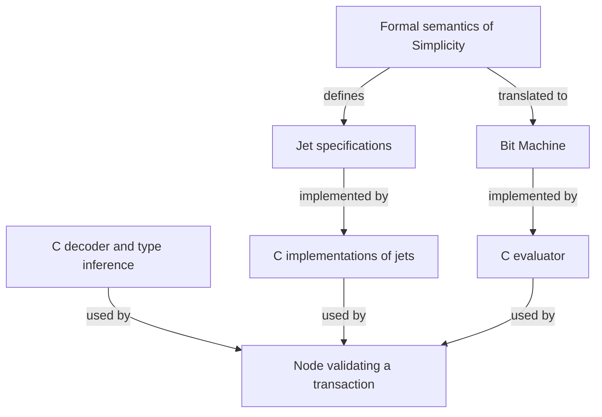

# Formal verification

Formal verification is the practice of proving, with a computer-checked mathematical proof, that a piece of software meets a precise specification. Testing runs software on chosen inputs and checks the results. A proof covers every possible input, and a proof checker confirms each step of the argument.

This page describes what has been formally verified about [Simplicity](../glossary.md#simplicity) and its implementations as of November 2026, what hasn't been verified yet, and what's planned.

## Design for formal verification

Simplicity was designed together with its formal semantics, with the goal that [programs](../glossary.md#program) and implementations could be reasoned about in an existing proof assistant. Several features of the language make that practical:

* The core language has nine [combinators](../glossary.md#combinator), and the formal definition of what every core program computes is about a dozen lines long. A proof about all programs can proceed by considering each combinator in turn.
* Every Simplicity expression denotes a function from one finite type to another. The language isn't [Turing complete](../glossary.md#turing-complete) and has no loops or recursion, so every program terminates, and proofs don't have to deal with programs that run forever.
* Programs don't have any mutable state. Their only effects are reading the [transaction](../glossary.md#transaction) and failing, and the semantics handle those in separate layers, so most of a program can be reasoned about as a pure mathematical function.
* Static analysis computes upper bounds on a program's memory use and [cost](../glossary.md#cost) from the program alone, before it runs. These bounds are statements about the program that can themselves be proved, and a memory bound has already been proved for core Simplicity.
* Each [jet](../glossary.md#jet) is specified by a Simplicity expression, so a program that uses jets has the same meaning as the same program written out in combinators. Proofs about the specification apply to the jet, to the extent that the jet's C code matches its specification (see [What has been verified](#what-has-been-verified) and [What hasn't been verified yet](#what-hasnt-been-verified-yet)).

## Tools

The proofs are written in the [Rocq proof assistant](https://rocq-prover.org/) (formerly Coq). Rocq checks every step of a proof mechanically, so a completed proof doesn't depend on a reviewer following the argument. A proof is only as useful as the statement it proves, though, so the specifications themselves still need human review.

Proofs about C code use the [Verified Software Toolchain](https://vst.cs.princeton.edu/) (VST), which proves properties of C programs using the precise definition of C from the [CompCert](https://compcert.org/) verified compiler. [Nodes](../glossary.md#node) are built with ordinary compilers such as GCC and Clang, so these proofs assume that those compilers translate the code correctly.

## Layers of verification

A Simplicity program passes through several layers between the code a developer writes and the decision a node makes about a transaction. Each implementation layer can be proved correct with respect to its specification.

The formal semantics define what every Simplicity program means as a mathematical function. The Bit Machine is an abstract machine that describes how programs are executed and how much memory they use. Nodes run an optimized C implementation of each jet instead of the Simplicity expression that specifies it. The C evaluator runs programs inside the node, after the decoder has read each program and checked its types. [SimplicityHL](../glossary.md#simplicityhl) programs are compiled to Simplicity, so proofs about SimplicityHL source code depend on the compiler being correct.

A complete chain of proofs would mean that a proof about a program's meaning is also a proof about which transactions nodes accept. That chain isn't complete yet.

## What has been verified

The formal semantics of Simplicity are defined in Rocq, along with the Bit Machine. Rocq proofs show that translating a Simplicity program to the Bit Machine preserves its meaning, and that a program's memory use stays within the bound that static analysis computes. These proofs cover the core Simplicity language, without extensions such as [witnesses](../glossary.md#witness), assertions, and jets, and they're about a straightforward translation, which differs from the optimized one that nodes use. Other proofs show that the Simplicity code for SHA-256 block compression matches a formal model of the SHA-256 standard and that the arithmetic building blocks compute the right integer results.

The largest body of recent work covers the C implementations of jets. A separate project, which used AI agents to write the proofs, has [checked the C code of every jet](https://github.com/BlockstreamResearch/simplicity/blob/master/docs/VERIFICATION-STATUS.md#verification-of-c-jet-implementations-against-compcert-c-semantics) in both [integrations](../glossary.md#integration) against its specification. All but one are proved to match, under the following conditions:

* Many proofs assume that standard C library functions such as `memcpy` behave as documented.
* The proofs apply to one version of the C code, on x86-64 Linux. For the secp256k1 field, scalar, and group jets, they cover a portable form of 128-bit arithmetic, but builds with GCC and Clang use the compiler's native 128-bit integers instead.
* Three jets (`output_is_fee`, `total_fee`, and `hash_to_curve`) depend on properties of SHA-256 that haven't been proved. If SHA-256 behaves like a random oracle, the property that the two fee jets need almost certainly doesn't hold, but finding an input where any of the three jets differs from its specification is infeasible.
* The proofs assume that the C data structures holding the transaction and the Bit Machine's state correctly represent the values in the model, and a few proofs exclude some extreme but valid memory addresses. The proofs for the Elements [introspection](../glossary.md#introspection) jets use a model of the transaction environment that hasn't been reviewed yet.
* One jet, `gej_ge_add_ex`, is proved to differ from its specification for some inputs that use a nonstandard encoding of a number: the two produce different encodings of the same value. The specification will be changed to match the deployed C code.

Rocq checks these proofs, but they haven't been reviewed or merged into the main Simplicity repository yet.

## What hasn't been verified yet

The following parts of the system don't have proofs yet:

* the C evaluator, which runs programs in the node
* the code that decodes programs and infers their types
* how nodes check a [Taproot](../glossary.md#taproot) spend that contains a Simplicity program, including the cost limit
* the SimplicityHL compiler
* the [rust-simplicity](https://github.com/BlockstreamResearch/rust-simplicity) library, which SimplicityHL tools use to encode programs and compute their [CMRs](../glossary.md#cmr)

These parts are tested. The test suite of Simplicity's Haskell library compares each C jet with its Haskell specification on random inputs, and checks that the C code decodes each jet and assigns it the right CMR and cost. The rust-simplicity library is fuzzed against the C implementation. Because of the gaps in proofs, though, a proof about a jet's C code doesn't yet extend to a guarantee about how nodes validate transactions.

## Proving properties of your own programs

In principle, you can prove properties of a Simplicity program in Rocq today using the formal semantics. In practice, several pieces are missing:

* There's no ready-made Rocq model of the transaction data that [Liquid](../glossary.md#liquid) or the [Simplicity Signet](../glossary.md#signet) provide, so reasoning about programs that use introspection jets requires building one first.
* Proofs about SimplicityHL source code depend on a verified compiler. Until then, proofs have to be about the compiled Simplicity program.
* There isn't a library of reusable results or verified example [contracts](../glossary.md#contract) yet.

Properties involving signatures or hashes, such as "only the holder of this key can spend this [output](../glossary.md#output)", also depend on cryptographic assumptions. Proofs of such properties can take the form of showing that a violation would require forging a signature or finding a hash collision.

!!! warning
    Test contracts thoroughly on Liquid testnet or the Simplicity Signet before relying on them. The [pitfalls](pitfalls.md) pages describe common mistakes in SimplicityHL contracts, such as checking an amount without checking its [asset](../glossary.md#asset), and how to avoid them.

## Planned work

Planned verification work includes the following, in no particular order:

* review and merging of the jet proofs
* Rocq models of the Liquid and Simplicity Signet transaction data
* proofs about the C evaluator, the decoder, and how nodes check Simplicity spends
* a formal specification of SimplicityHL and a proof that the compiler is correct
* a verified version of the SimplicityHL [standard library](stdlib.md)
* tools and example proofs for developers who want to verify their own contracts

The Simplicity repository has a detailed [verification roadmap](https://github.com/BlockstreamResearch/simplicity/blob/master/docs/VERIFICATION.md) and a [status reference](https://github.com/BlockstreamResearch/simplicity/blob/master/docs/VERIFICATION-STATUS.md) for people working on the proofs. The existing proofs are in the repository's [`Coq` directory](https://github.com/BlockstreamResearch/simplicity/tree/master/Coq).
