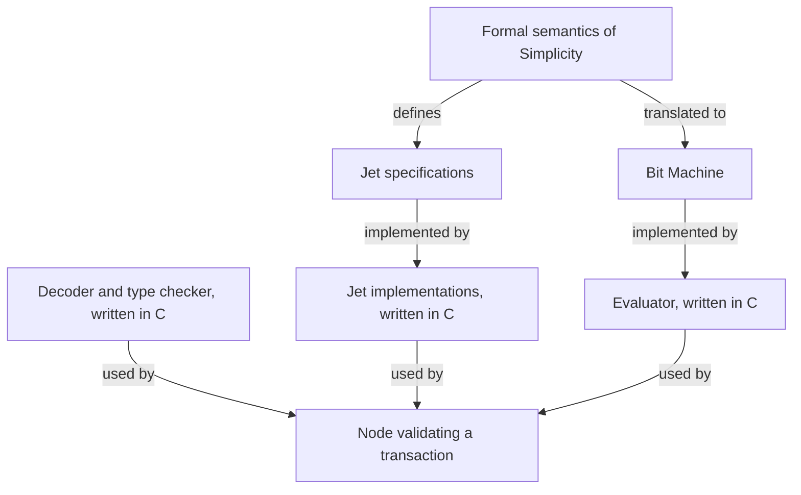

# Formal verification

Formal verification means proving, with a computer-checked mathematical proof, that a piece of software meets a precise specification. Unlike testing, which checks only specific inputs, a proof covers every possible input. For developers building on Simplicity, formal verification has several concrete benefits:

* A [contract](../glossary.md#contract) can't be patched after funds are committed to it, and attackers search for exactly the inputs that tests miss. A proof about a contract covers those inputs too.
* Every [node](../glossary.md#node) has to reach the same decision about every [transaction](../glossary.md#transaction). A proof that an optimized [jet](../glossary.md#jet) implementation matches its specification means that every node running it computes the same result that the specification defines, for every input.
* A program's [cost](../glossary.md#cost) and memory limits are computed before the program runs. A proof that these limits are correct means that no input can make a program use more resources than its computed limits.
* A formal specification states exactly what each operation does, including in edge cases that documentation tends to leave out.

This page describes what has been formally verified about [Simplicity](../glossary.md#simplicity) and its implementations as of November 2026, what hasn't been verified yet, and what's planned.

## Design for formal verification

Simplicity was designed together with its formal semantics, with the goal that [programs](../glossary.md#program) and implementations could be reasoned about in an existing proof assistant. Several features of the language make that practical:

* The core language has nine [combinators](../glossary.md#combinator), and the formal definition of what every core program computes is about a dozen lines long. A proof about all programs can proceed by considering each combinator in turn.
* Every Simplicity expression denotes a function from one finite type to another. The language isn't [Turing complete](../glossary.md#turing-complete) and has no loops or recursion, so every program terminates, and proofs don't have to deal with programs that run forever.
* Programs don't have any mutable state. Their only effects are reading the transaction and failing, and the semantics handle those in separate layers, so most of a program can be reasoned about as a pure mathematical function.
* Static analysis computes upper bounds on a program's memory use and cost from the program alone, before it runs. These bounds are statements about the program that can themselves be proved, and a memory bound has already been proved for core Simplicity.
* Each jet is specified by a Simplicity expression, so a program that uses jets has the same meaning as the same program written out in combinators. Proofs about the specification apply to the jet, to the extent that the jet's implementation matches its specification (see [Progress](#progress)).

## Tools

The proofs are written in the [Rocq proof assistant](https://rocq-prover.org/) (formerly Coq). Rocq checks every step of a proof mechanically, so a completed proof doesn't depend on a reviewer following the argument. A proof is only as useful as the statement it proves, though, so the specifications themselves still need human review. A proof also doesn't account for behavior that its specification leaves out, such as hardware faults that change the contents of memory.

Nodes run Simplicity programs using the Simplicity library, which is written in the C programming language. Proofs about code written in C use the [Verified Software Toolchain](https://vst.cs.princeton.edu/) (VST), which proves properties of C programs using the precise definition of the C language from the [CompCert](https://compcert.org/) verified compiler. Nodes are built with ordinary compilers such as GCC and Clang, so these proofs assume that those compilers translate the code correctly.

## Layers of verification

A Simplicity program passes through several layers between the code a developer writes and the decision a node makes about a transaction. Each implementation layer can be proved correct with respect to its specification.

The formal semantics define what every Simplicity program means as a mathematical function. The Bit Machine is an abstract machine that describes how programs are executed and how much memory they use. Nodes run an optimized implementation of each jet, written in C, instead of the Simplicity expression that specifies it. The evaluator, also written in C, runs programs inside the node, after the decoder has read each program and checked its types. [SimplicityHL](../glossary.md#simplicityhl) programs are compiled to Simplicity, so proofs about SimplicityHL source code depend on the compiler being correct.

## Progress

:material-check-circle: done &nbsp; :material-circle-half-full: partly done &nbsp; :material-circle-outline: not started

The table follows the layers above. Its order doesn't indicate priority.

| | Goal | Notes |
| --- | --- | --- |
| :material-check-circle: | Formal semantics of Simplicity and the Bit Machine | Defined in Rocq |
| :material-circle-half-full: | Translation to the Bit Machine preserves meaning and stays within the memory bound | Proved for core Simplicity and a straightforward translation. The full language and the optimized translation that nodes use aren't covered yet. |
| :material-circle-half-full: | Simplicity expressions for jets match their mathematical definitions | Done for SHA-256 block compression and the integer arithmetic building blocks |
| :material-circle-outline: | Rocq models of the transaction data that Liquid and the Simplicity Signet provide | |
| :material-circle-half-full: | Jet implementations, written in C, match their specifications | Every jet has been checked on a separate branch, and all but one match, under the [conditions below](#conditions-on-the-jet-proofs). Rocq checks the proofs, but they haven't been reviewed or merged yet. |
| :material-circle-outline: | Evaluator, written in C | |
| :material-circle-outline: | Decoder and type checker, written in C | |
| :material-circle-outline: | How nodes check a [Taproot](../glossary.md#taproot) spend that contains a Simplicity program, including the cost limit | |
| :material-circle-outline: | The [rust-simplicity](https://github.com/BlockstreamResearch/rust-simplicity) library, which SimplicityHL tools use to encode programs and compute their [CMRs](../glossary.md#cmr) | Tested against the Simplicity library with fuzzing |
| :material-circle-outline: | Formal specification of SimplicityHL, and a proof that the compiler is correct | |
| :material-circle-outline: | Verified SimplicityHL [standard library](stdlib.md) | |
| :material-circle-outline: | Tools and example proofs for developers who want to verify their own contracts | |

A complete chain of proofs from the formal semantics to the node would mean that a proof about a program's meaning is also a proof about which transactions nodes accept. Until the unfinished items are done, a proof about a jet's implementation doesn't extend to a guarantee about how nodes validate transactions.

### Conditions on the jet proofs

A separate project, which used AI agents to write the proofs, has [checked the implementation of every jet](https://github.com/BlockstreamResearch/simplicity/blob/master/docs/VERIFICATION-STATUS.md#verification-of-c-jet-implementations-against-compcert-c-semantics) in both [integrations](../glossary.md#integration) against its specification. All but one are proved to match, under the following conditions:

* Many proofs assume that functions from the C language's standard library, such as `memcpy`, behave as documented.
* The proofs apply to one version of the code, on x86-64 Linux. For the secp256k1 field, scalar, and group jets, they cover a portable form of 128-bit arithmetic, but builds with GCC and Clang use the compiler's native 128-bit integers instead.
* Three jets (`output_is_fee`, `total_fee`, and `hash_to_curve`) depend on properties of SHA-256 that haven't been proved. If SHA-256 behaves like a random oracle, the property that the two fee jets need almost certainly doesn't hold, but finding an input where any of the three jets differs from its specification is infeasible.
* The proofs assume that the data structures holding the transaction and the Bit Machine's state correctly represent the values in the model, and a few proofs exclude some extreme but valid memory addresses. The proofs for the Elements [introspection](../glossary.md#introspection) jets use a model of the transaction environment that hasn't been reviewed yet.
* One jet, `gej_ge_add_ex`, is proved to differ from its specification for some inputs that use a nonstandard encoding of a number: the two produce different encodings of the same value. The specification will be changed to match the deployed implementation.

### Testing

The parts without proofs are tested. The test suite of Simplicity's Haskell library compares each jet's implementation in C with its Haskell specification on random inputs, and checks that the decoder, written in C, decodes each jet and assigns it the right CMR and cost. The rust-simplicity library is fuzzed against the Simplicity library written in C.

## Proving properties of your own programs

In principle, you can prove properties of a Simplicity program in Rocq today using the formal semantics. In practice, several pieces are missing:

* There's no ready-made Rocq model of the transaction data that [Liquid](../glossary.md#liquid) or the [Simplicity Signet](../glossary.md#signet) provide, so reasoning about programs that use introspection jets requires building one first.
* Proofs about SimplicityHL source code depend on a verified compiler. Until then, proofs have to be about the compiled Simplicity program.
* There isn't a library of reusable results or verified example contracts yet.

Properties involving signatures or hashes, such as "only the holder of this key can spend this [output](../glossary.md#output)", also depend on cryptographic assumptions. Proofs of such properties can take the form of showing that a violation would require forging a signature or finding a hash collision.

!!! warning
    Test contracts thoroughly on Liquid testnet or the Simplicity Signet before relying on them. The [pitfalls](pitfalls.md) pages describe common mistakes in SimplicityHL contracts, such as checking an amount without checking its [asset](../glossary.md#asset), and how to avoid them.

## Further information

The Simplicity repository has a detailed [verification roadmap](https://github.com/BlockstreamResearch/simplicity/blob/master/docs/VERIFICATION.md) and a [status reference](https://github.com/BlockstreamResearch/simplicity/blob/master/docs/VERIFICATION-STATUS.md) for people working on the proofs. The existing proofs are in the repository's [`Coq` directory](https://github.com/BlockstreamResearch/simplicity/tree/master/Coq).
