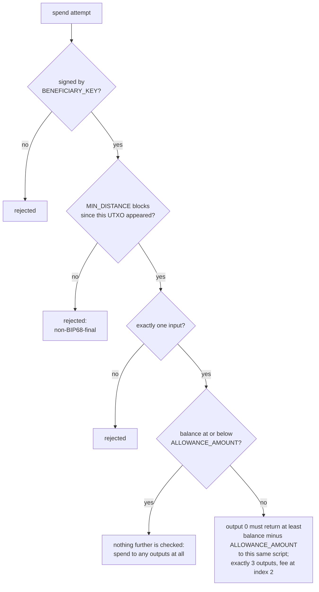

# How the allowance covenant works, and why it is built this way

Background reading. **If you want to run the thing, start with [`HOWTO.md`](HOWTO.md)**: none of this
is needed to complete those steps. For exact shapes and field behaviour rather than
reasoning, see [`REFERENCE.md`](REFERENCE.md).

## What a Simplicity covenant is, at the level needed here

The contract compiles to a single [Taproot](../../glossary.md#taproot) leaf script. Spending a [UTXO](../../glossary.md#utxo) locked to it means
satisfying that script, and this contract's logic makes that conditional on a valid
signature, on the shape of the spending transaction's own outputs, and on how much time
has passed since the UTXO was created.

Three values are fixed at compile time and baked into the address: `BENEFICIARY_KEY` (a
BIP340 x-only pubkey), `ALLOWANCE_AMOUNT` (satoshis withdrawable per period), and
`MIN_DISTANCE` (blocks between withdrawals). Change any of them and you have a different,
unrelated allowance at a different address. The [witness](../../glossary.md#witness) is a single `SIGNATURE`, checked
against `BENEFICIARY_KEY` by `checksig()`; no other spending key exists.

Vocabulary used throughout: the **benefactor** funds an allowance, the **beneficiary**
draws it down and holds the only key that can, and an **instance** is one funded
allowance. One UTXO at the covenant address is exactly one instance.

## What the contract enforces

Every spend runs the same four checks, and only then splits on the balance:

The `yes` branch out of that last check is the surprising one: once the balance is at or
below `ALLOWANCE_AMOUNT`, the contract stops constraining the transaction entirely.

### Two spend shapes, selected by balance rather than by the spender

`main()` calls `full_withdrawal()` to compare the covenant's current on-chain balance
against `ALLOWANCE_AMOUNT`. At or below it, the beneficiary may take everything and the
covenant ends. Above it, `partial_withdrawal()` runs.

No witness field says which action is intended. That is why the txmanifest models this as
two separate actions, `PartialWithdraw` and `FullWithdraw`, with the caller picking
whichever one the current balance makes valid. A single parameterised "Withdraw" action
would be unimplementable.

### The full-withdrawal path enforces no transaction shape at all

`main()`'s match arm is literally `true => ()`, so nothing further is checked on that
branch. Once the balance has dropped to `ALLOWANCE_AMOUNT` or less, the contract requires
only the beneficiary's signature and the BIP68 [timelock](../../glossary.md#timelock), and the beneficiary may spend to
any outputs. The payout-plus-fee shape the tooling builds for `FullWithdraw` is the
[manifest](../../glossary.md#manifest)'s choice rather than a rule the script imposes. This is the most surprising
property of the contract and the easiest to miss.

### What `partial_withdrawal()` checks

It computes `difference = balance - ALLOWANCE_AMOUNT` and asserts
`difference <= retained_amount`, where `retained_amount` is the amount on output 0. The
rule is a lower bound on what stays in the covenant, equivalently a ceiling of
`ALLOWANCE_AMOUNT` on what may leave it. It bounds the amount leaving rather than fixing
it, so retaining more than required is valid, and it never reads output 1's amount.

The beneficiary nets `ALLOWANCE_AMOUNT` minus the [fee](../../glossary.md#fee), with the fee coming out of that
same slack, because `enforce_single_input()` doesn't leave anywhere else for it to come
from.

### `same_asset()` checks assets as well as amounts

Anyone can issue an [Elements](../../glossary.md#elements) [asset](../../glossary.md#asset) carrying any amount at no cost, so comparing amounts
alone is satisfiable with worthless tokens. `partial_withdrawal()` reads both the
covenant's balance and output 0's amount through `same_asset()`, which asserts the two are
denominated in the same asset and returns the amounts from that same call. The amounts
cannot be read without the asset check having happened.

### `recursive_covenant()`

Reached only from the partial-withdrawal path, it pins that path's transaction shape:
exactly 3 outputs, output 0's script hash equal to the currently-executing script's own
hash (the recursive part, since it recreates itself), and output 2 an Elements explicit
fee output. It does not pin output 1's identity or amount. That slack is what lets a
wallet with no `fee` keyword still build a correct withdrawal.

### `enforce_single_input()`

Exactly one input, always. Two consequences shape everything downstream. Fees can only
come out of the allowance's own balance, since no outside input can help pay them. And two
UTXOs sent to the same contract address are two separate instances that can never be
merged, so paying the address a second time does not top up the first.

### `enforce_relative_distance()`

The BIP68 check. It requires `jet::parse_sequence` to decode the spending transaction's
sequence as a block-distance encoding specifically, rejecting a time-based BIP68 encoding
outright, and it requires transaction version 2 or later.

`MIN_DISTANCE` is a count of blocks, checked via the spending transaction's `nSequence`
field against the funding UTXO's own confirmation height. [Liquid](../../glossary.md#liquid) blocks come from
scheduled signers rather than proof-of-work search, so block time is about one minute with
very low variance and "N blocks" translates reliably to "about N minutes".

The timelock measures the age of one UTXO. The contract counts blocks since whichever
transaction created it, and cannot distinguish the benefactor's deposit from the
continuation output of a previous withdrawal. The clock therefore restarts after every
partial withdrawal.

## Confidential and explicit outputs

Liquid outputs can hide their asset and amount. That default is the right one in general,
but a covenant that reasons about its own value cannot read a blinded amount: this
contract panics on one. A confidential output sent to the covenant address permanently
strands the funds.

The decision is per output rather than per transaction:

| Output | Must be | Why |
|---|---|---|
| The funding output, and the continuation at index 0 | explicit | the contract reads the asset and amount |
| The fee output at index 2 | explicit | Elements fee outputs always are |
| The beneficiary payout at index 1 | either | the contract never inspects it |

So the privacy cost is narrower than "covenants cannot be confidential". It is confined to
the covenant's own value, and the payout could be blinded. For this contract that buys
less than it appears to, because the covenant balance is public at every step, so
differencing consecutive balances recovers each withdrawal amount regardless. What
blinding the payout hides is the destination.

The two mistakes are badly asymmetric. Getting it wrong on a covenant output strands the
funds silently and permanently; getting it wrong elsewhere raises a confusing error. The
transferable rule is to ask, for each output, whether the contract reads it.

## Why the architecture looks like this

### What the txmanifest does

A txmanifest teaches a wallet to recognise, describe, build and sign transactions for a
contract it has never seen. It is what lets a page delegate the whole transaction: the
manifest says what a transaction for this covenant looks like, so the page doesn't have to
say it in code.

`utxo_types.allowance` names the UTXO shape the contract produces, pointing at the `.simf`
source and mapping compile-time parameter names to where their values come from.
`contract_templates.allowance_contract.fields` declares the three parameters with types.
Then three actions: the contract's two spend paths, plus `Fund`, which is an ordinary
wallet payment to the covenant address and corresponds to no branch of the contract at
all.

An instance file holds one allowance's fixed terms, written once at funding and read by
every later action. A state file records where the current UTXO is and changes on every
spend. The engine in
[`REFERENCE.md`](REFERENCE.md#other-ways-to-drive-the-same-contract) uses files for both; the browser pages keep the
equivalent in `localStorage` and rediscover the UTXO from the chain.

For the page rather than the manifest,
[`examples/allowance-lwk/README.md`](examples/allowance-lwk/README.md) walks its seven
parts in order, with the library's ownership rules that cost the most time to discover.
[`examples/allowance-humid-only/README.md`](examples/allowance-humid-only/README.md) does
the same for the variant that carries no
library, which is the shorter read if you want the division of labour on its own.

### Writing a manifest for a different contract

Work out the same mapping from that contract's source. Six things to get right:

One `utxo_types` entry per distinct UTXO shape the contract produces, each mapping
`compile_params` onto the contract's real `param::` names.

One `contract_templates` entry with a typed field for every compile-time parameter. These
get baked into the address, so a missing field or wrong type produces a *different
address* rather than a broken transaction, which is how funds end up somewhere nothing can
spend them from.

One action per spend path the contract implements, plus any action that is not a covenant
spend. Count branches in the contract rather than intents in your UI.

Where the contract selects its branch from on-chain state rather than from the witness,
the manifest has to expose that as separate actions, as this one does.

Per action, pin `witnesses`, `sequence`, outputs and `required_index` to what the contract
checks. If the contract compares output 0's script hash against its own, that output needs
`required_index: 0`.

Target the dialect of the engine that will read it. The two known implementations disagree
on `manifest_version` and on where `confidential` may appear, and both are moving targets,
so confirm against the engine's own fixtures before concluding a manifest is wrong.
[`REFERENCE.md`](REFERENCE.md#the-two-manifest-dialects-here) records the current
divergence.

### Checking a manifest you did not write

Drafting a manifest from contract source is mechanical enough to delegate, including to an
AI assistant. Reviewing it is not optional. A wrong manifest fails safe in the best case,
where the engine refuses to build anything, and unsafely in the worst, where an incorrect
`amount_sat` expression still satisfies the contract's checks. Check that the generated
actions match the contract's real branches, that pinned output positions and amounts
correspond to what the contract enforces, and that nothing was invented to fill a gap.

A draft produced from the schema alone tends to be structurally valid and semantically
wrong, which is the expensive failure mode. Hand over the contract source, the
[txmanifest book](https://stringhandler.github.io/tx_manifest_book/), the schema, and one
known-good manifest for a different contract.

### Who signs, and what that changes

The page the guide drives carries both signers, and they are two ends of a range rather
than rival technologies to pick between.

**In the page**, through LWK compiled to wasm: the page loads the library, compiles the
contract, derives the address, builds the transaction and signs it with a key in
`localStorage`. Steps 4 to 10 work this way.

**In a wallet**, through a manifest: the page hands Humid `txmanifest.humid.json` and the
contract source, and the extension compiles, builds, signs and broadcasts, showing the
user its own confirmation. Step 11 works this way.

The two produce different covenant addresses for the same stated terms, because Humid signs
with its own BIP-84 key and so supplies a different `BENEFICIARY_KEY`. A single allowance
therefore belongs to one signer or the other for its whole life.

A real project would take the useful half of each: **a manifest to a wallet for anything
involving a key, plus a library in the page for the application's own work.** Delegating
signing is the part worth keeping permanently, since it is what keeps a user's keys in the
wallet where they belong and puts the wallet's review screen in front of them. Signing in
the page, as Steps 4 to 10 do, keeps the guide runnable before the extension is built, and
is better read as a way to exercise the library than as an architecture to copy.

What a larger project would want from the library is narrower than "everything the wallet
does", and it is worth being precise about which parts, because the answer decides whether
a 15 MB wasm module has to be in the page at all:

- **Compiling the contract and deriving its address is the irreducible one.** Nothing in
  plain JavaScript computes a [CMR](../../glossary.md#cmr) or a Taproot output key for a [SimplicityHL](../../glossary.md#simplicityhl) program.
  Any feature that verifies terms, shows a user which contract they are about to fund, or
  supports more than one set of compile-time parameters needs this, and needs it in the
  page.
- **Parsing Elements transactions properly is the next one.** The wallet-driven example
  recovers the covenant address from a funding transaction with a regular expression over
  the raw hex, which works only because it is hunting for one known output shape. Anything
  with more than one output shape to distinguish needs a real parser.
- **Key and signature handling is already library work today**, even on the path with no
  wasm: that page carries three JavaScript imports for BIP32 and secp256k1. "No wasm" has
  never meant "no libraries".
- **Indexing is not library work and never becomes it.** Neither LWK nor the wallet offers
  an address-based UTXO lookup, so listing what is live at a covenant address stays the
  application's own code against an explorer API on every architecture. It is the largest
  single piece of the wallet-driven example, and choosing a different library does not
  shrink it.

So the honest version is not that raw JavaScript runs out in general; it is that two
specific capabilities, compiling and transaction parsing, have no JavaScript substitute,
and a project needing either has to bring a library that provides them. Everything else is
a size-and-dependency judgement: narrow JS libraries where they suffice, wasm where only
it will do.

### What the examples are not

These are testnet demos, and two of their choices would be wrong for real money.

**Custody.** Signing in the page means a mnemonic and a bare Schnorr key in
`localStorage`, in plaintext. That is fine for play money and unacceptable for anything
else. Real funds need a real wallet, which is what the manifest path already is. This is
the strongest reason to treat the wallet as permanent architecture rather than as a
convenience, and to read the in-page signing as a way to exercise the library rather than
as a design.

**Knowing what exists.** What the manifest format does today is *review*: given one
proposed action, describe its consequences to the user accurately enough that they are not
blind-signing. What it does not do is *planning*: look at every unspent output and work out
which actions would currently succeed or fail. Those are different jobs, and only the first
is in scope for a wallet as the format stands.

So the wallet is handed one position and one action and asked to build that. It does not
tell a user which contract positions they hold or which actions are available on them.
`resolveActionRequirements` requires the caller to supply both `instance` and `state` on
every withdrawal, because the wallet neither remembers a previous `Fund`'s terms nor scans
the chain for the right UTXO.
Discovery, and deciding that this instance is a `FullWithdraw` while that one still has
eleven blocks to wait, is the application's work on every architecture.

Both examples do that work by polling a public explorer from the browser, on a shared
endpoint nobody here operates. A product needs an indexer it runs or pays for, server-side,
with its own rate budget, retries and fallback, because a beneficiary's ability to see "I
can withdraw now" otherwise rests on a free third-party service staying up and honest. The
browser loop here exists to keep the examples self-contained, not because it is the right
shape.

It is worth naming what would change this. A wallet already holds some of the pieces: the
manifest gives it the covenant's script, the `utxo_type` its instances carry, and the
actions that can spend them. Generating a portfolio view from that is not technically
impossible, and more capable wallet-side generation is one direction this could grow in.

It is worth being skeptical that it is the direction, though, because planning needs
something the format does not currently express. Deciding which action is available on a
given instance means evaluating the contract's own conditions against chain state: here,
that a balance at or below `ALLOWANCE_AMOUNT` makes `FullWithdraw` the valid action and
anything above it `PartialWithdraw`, and that `MIN_DISTANCE` blocks must have passed. The
manifest states the actions and their shapes, not the predicate that selects between them,
and the expression language is small enough that a bare `fee` reference in an amount is
unimplemented. Carrying eligibility rules would be a real expansion of what the format
expresses, not just more user interface on top of it.

So the more likely near-term shape is that planning lands in a library or a service that
several applications share, rather than inside wallets. Either way it is work somebody has
to do, and today it is the application's: this is the piece none of the architectural
choices above make smaller.

So a real deployment has three parts rather than two: a wallet holding the keys and signing
from a manifest, an indexer the project operates, and a user interface that needs the
compiling and transaction-parsing capabilities named above. The examples here cover the
first and third. They don't cover the second, and only the manifest path shows custody
worth copying.

### Why manifests are security-sensitive

The wallet never fetches a manifest; it arrives from the calling page, and nothing signs
it. The format reserves `attestation_version` for a signature slot that no implementation
reads. Descriptions in a manifest are shown to the user and are therefore untrusted text.

What protects a user is that the amounts are not taken from the manifest. The wallet tags
every displayed value with its origin, and the ones a user sees as amounts are computed by
the wallet from the chain. A manifest can name and describe itself freely and cannot alter
the numbers. [`REFERENCE.md`](REFERENCE.md#how-humid-treats-a-manifest) has the specifics.

### The ELIPs this rests on

The [Wallet RPC ELIP](https://github.com/ElementsProject/ELIPs/pull/36) is a generic
dApp-to-wallet RPC transport. The
[Tx Manifest ELIP](https://github.com/ElementsProject/ELIPs/pull/41) is the JSON format
above. The [Simplicity Clear Signing ELIP](https://github.com/ElementsProject/ELIPs/pull/40)
is what the wallet's review layer implements: showing a user what an unfamiliar covenant's
transaction does, and refusing to build rather than misbuilding when it cannot establish
that.

## What a mainnet deployment would require

Do not run any of this against mainnet. The long form is in
[`docs-notes/mainnet-notes.md`](docs-notes/mainnet-notes.md); in brief:

Mechanical swaps: the chain parameter, the Esplora endpoint, the real LBTC asset id
(confirmed live from a trusted source at deploy time, since it is security-critical), and
the address encodings.

Five things that are engineering rather than configuration. None of the paths here has key
custody fit for real funds: the self-contained page keeps a mnemonic and signing key in
`localStorage` in plaintext. Delegating signing to a wallet is structurally the right
answer, but the wallet used here is early-stage software not intended for real-money use
in any form today. The confidential-output hazard needs much stronger guardrails, because
a stranded mainnet UTXO is an irreversible loss. Fee estimation has to work rather than
falling back to a hardcoded testnet rate. The contract needs an independent security audit
before real funds go behind it. And the indexer needs infrastructure the deploying party
controls rather than a shared public Esplora instance.

Unchanged: the contract source, since Simplicity covenants are chain-parameter-agnostic at
the script level; the transaction shapes; and the core indexer logic.

---

## Doing it

The eleven steps that put this on chain are in [`HOWTO.md`](HOWTO.md). If you are adapting the contract
or writing a manifest for a different one, the sections above on what the contract
enforces and on writing a manifest are the two to reread first.
