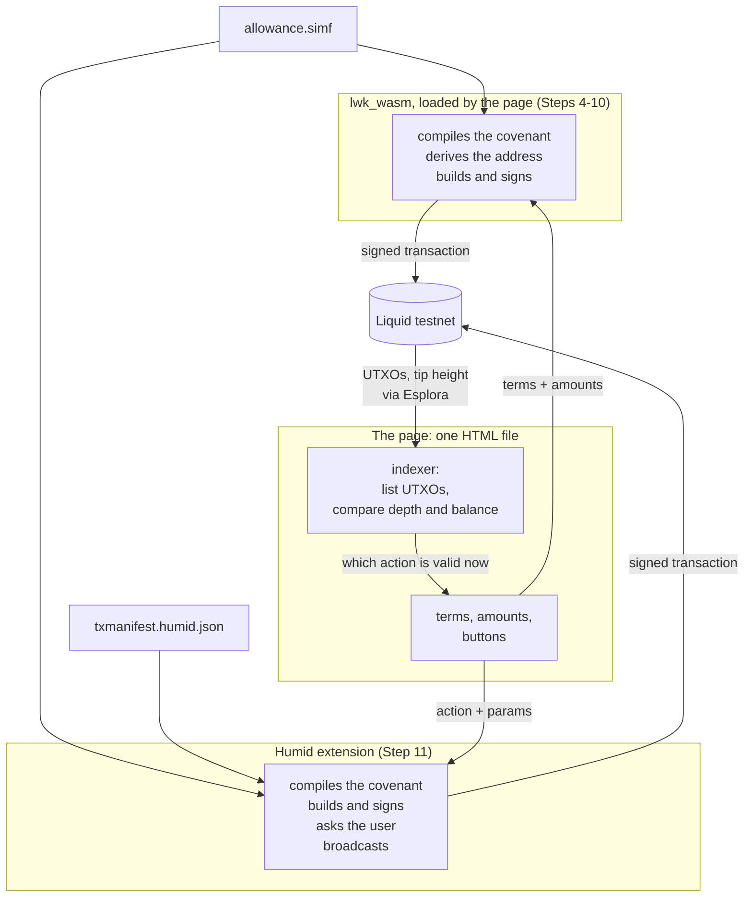
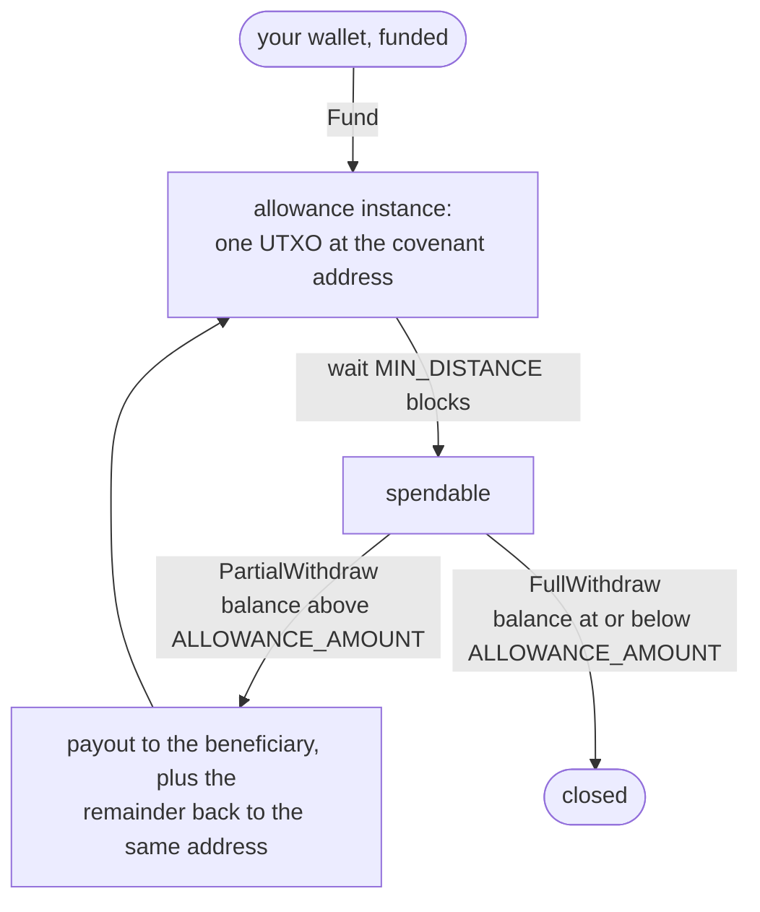

# Run an allowance covenant end to end

**Goal**: lock testnet L-BTC in a [Simplicity](../../glossary.md#simplicity) covenant, withdraw from it on a schedule, and
close it out, driven from a web page you can edit.

**Scope**: [Liquid](../../glossary.md#liquid) testnet only. No step here costs money.

**Tested with**: Simplex 0.1.0 with `smplx-std` 0.1.1, Rust 1.91.1, `wasm-pack` 0.15.0,
Bun 1.4.3, LWK at commit `7ad29620`, and Humid 1.1.4 at commit `a6d211d` with the patch
from Step 3c, in Chromium.

## Get the files

```bash
git clone https://github.com/BlockstreamResearch/simplicity-demo
cd simplicity-demo/allowance-web
```

The contract, the manifests, the worked examples and the wallet patch all live there.
Read these steps in a browser and run the commands in that directory.

## What you need

`git`, `curl` and `python3` are assumed, and are already present on most Unix desktops.
Python is used only to serve static files. Step 3 builds WebAssembly modules and a
browser extension from source, so you need the tools below as well:

| Tool | Needed by | How to get it |
|---|---|---|
| A browser | Step 4 onwards; Step 11 needs one that can load this extension | currently Chromium or Google Chrome; most other browsers cannot load it |
| Rust and `cargo` | Steps 2 and 3 | `apt install rustup` or `brew install rustup`, then `rustup default stable` |
| `simplex` | Step 2 only | `cargo install --git https://github.com/BlockstreamResearch/smplx smplx-cli`, or the upstream installer script |
| Bun | Step 3c only | `npm install -g bun` or `brew install oven-sh/bun/bun` |
| `wasm-pack` | Step 3 | `cargo install wasm-pack` |
| LLVM `clang` targeting wasm32, with `llvm-ar` | Step 3 | your distribution's `llvm` and `clang` packages; `brew install llvm` on macOS |

Every command below runs from that `allowance-web` directory, unless it says otherwise.
Several steps clone another repository and leave you inside it, so name the directory
once and the later steps can send you back to it:

```bash
GUIDE="$(pwd)"       # allowance-web, from the clone above
```

Each later block that depends on the directory starts with `cd "${GUIDE:?}"`, which
stops with an error if `GUIDE` isn't set. If you run commands in a fresh shell each time,
set `GUIDE` to the same absolute path at the start of every block.

Steps 2, 3b and 3c clone `smplx`, `lwk` and `humid` into `$GUIDE`. They are ordinary
clones and you can delete them when you are done.

However you install these, this is the state the later steps need. Check what you already
have in one go:

```bash
git --version && curl --version | head -1 && python3 --version
cargo --version          # 1.91 or newer, which Step 2 requires
wasm-pack --version      # no pinned minimum; a current release is fine
bun --version            # 1.3.14 or newer, which Step 3c requires
clang -print-targets | grep -q wasm32 \
    && echo "clang wasm32 target: present" \
    || echo "clang wasm32 target: MISSING, install LLVM from your package manager"
```

Every line should give output, the two pinned versions should be satisfied, and the last line should say that `wasm32` is present.

The [Simplex](../../glossary.md#simplex) workspace requires Rust 1.91.0, and Humid
requires Bun 1.3.14. LWK, in Step 3b, pins Rust 1.85.0 in its own `rust-toolchain.toml`.
`rustup` fetches that toolchain for you, but a distribution `rustc` ignores the file, so
install Rust through `rustup`.

If your system has neither `apt` nor Homebrew, both projects publish a shell installer:

```bash
curl --proto '=https' --tlsv1.2 -sSf https://sh.rustup.rs | sh    # Rust
curl -fsSL https://bun.sh/install | bash                          # Bun
```

For LLVM, the package names are the same across the common distributions: `apt install llvm clang`, `dnf install llvm clang`, or `pacman -S llvm clang`.

???+ "`clang` on macOS"
    The system `clang` has no WebAssembly backend, so install LLVM from Homebrew and make sure that copy is the one on your `PATH`. A `clang` without a wasm32 target fails deep inside a Rust crate build, with an error that doesn't mention wasm.

There are two companion documents, neither of which is required to complete these steps.

- [`REFERENCE.md`](REFERENCE.md) is for looking things up while you work: exact RPC shapes, [manifest](../../glossary.md#manifest)
  field behavior, and an error-to-cause table. Especially from Step 4 on, if a
  command fails with a message you don't recognize, look there first.
- [`EXPLANATION.md`](EXPLANATION.md) is background on the [smart contract](../../glossary.md#smart-contract) itself, what it enforces, and why the architecture looks like this. Read it if you want to understand what you built, or before adapting any of it to a different contract.

## The pieces

Reads come straight from the chain. Writes are signed either in the page, by the library
built in 3b, or by a wallet handed a manifest. The manifest is what lets a wallet handle a
covenant it has never seen.



Every piece here is provided as a worked example, so these steps don't have you write anything.
In a project of your own, the compiling, address derivation and signing are the parts you
get from a library or a wallet; the contract, the manifest, the interface and the indexer
would all be yours. Which of those a larger project can avoid writing is in
[`EXPLANATION.md`, "Who signs, and what that
changes"](EXPLANATION.md#who-signs-and-what-that-changes).

---

## 1. Get the contract

Every later step compiles this one file. It is already here:

```bash
cat contracts/allowance.simf
```

Three values are compiled into it and fix its address. `BENEFICIARY_KEY` is the only key
that can withdraw, `ALLOWANCE_AMOUNT` caps how much leaves per withdrawal, and
`MIN_DISTANCE` is how many blocks must pass between withdrawals.

You should see about 160 lines of [SimplicityHL](../../glossary.md#simplicityhl), ending in `fn main()`.
Comments ending in `// (1)!` and so on are annotation markers, which docs.simplicity-lang.org
renders as notes; they don't affect compilation.

For what each function enforces, see
[`EXPLANATION.md`, "What the contract enforces"](EXPLANATION.md#what-the-contract-enforces).

## 2. Run the contract's tests on regtest

`simplex` runs SimplicityHL integration tests against a local [Elements](../../glossary.md#elements)
regtest node that it starts and funds for you, so this step checks the
contract's behavior before anything touches a real chain.

This step needs Rust and the Simplex tool. If `cargo --version` fails, install `rustup` by
any of the routes in "What you need" above, then:

```bash
rustup default stable
```

Then install Simplex. Build it from a clone:

```bash
cd "${GUIDE:?}"
git clone https://github.com/BlockstreamResearch/smplx
cargo install --path smplx/crates/cli --locked
```

`cargo install` compiles Simplex and its dependencies, which takes several minutes.

`crates/cli` is the crate that provides the `simplex` binary. To skip the clone, install
the same crate straight from the repository:

```bash
cargo install --git https://github.com/BlockstreamResearch/smplx smplx-cli
```

???+ warning "Avoid Simplex version skew"
    Neither installation form pins a version, and the binary and the
    library have to come from the same release: the `simplex` binary
    generates the code in `src/artifacts/`, so an older library rejects
    what a newer binary writes, with a type error about `Program::new`.

Upstream also publishes an installer script, `curl -L https://smplx.simplicity-lang.org |
bash` followed by `simplexup`. If you already have `simplex` that way, use it and skip
both builds above. `REFERENCE.md` covers how the two installations interact.

Then set up the project and run the tests:

```bash
cd "${GUIDE:?}"
simplex init allowance_example && cd allowance_example
rm tests/p2pk_test.rs simf/p2pk.simf                            # init's own sample
sed -i 's/^name = .*/name = "allowance_example"/' Cargo.toml
cargo add anyhow@1
cp "$GUIDE/examples/allowance-simplex/simf/allowance.simf" ./simf/
cp "$GUIDE/examples/allowance-simplex/tests/allowance_test.rs" ./tests/
simplex build && simplex test
```

On macOS, `sed -i` wants an argument: use `sed -i ''` instead.

Three of those lines tidy up after `simplex init`: it leaves a sample contract and a
sample test behind, names the package after the directory with a `simplex_` prefix, and
declares no `anyhow`, which a test needs. `REFERENCE.md` explains each.

The library here is `smplx-std`, and the crate it exports is `simplex`.

If `simplex build` reports a missing SimplicityHL standard library, run `simplex install
std` once and build again.

You should see two passing tests. One walks a full lifecycle; the other attempts a
withdrawal before the [timelock](../../glossary.md#timelock) and is rejected by the node under BIP68.

```bash
cd "${GUIDE:?}/allowance_example"
simplex test -- -vv        # traces every jet call with its real values
```

[`examples/allowance-simplex/README.md`](examples/allowance-simplex/README.md) describes
more tests to write yourself.

## 3. Build what the page needs

Two things get built here: the Liquid library the page itself calls, and the browser
extension the page can hand a manifest to. Neither has a prebuilt download that carries
what this contract needs, so both come from source. This is the longest step in the guide,
and most of it is waiting.

The `wasm-pack` build and the two `build:wasm` scripts each run for several minutes, with
long stretches that don't print anything. If you run commands through a tool that times
out, run these in the background or raise its timeout, and treat silence as normal.

### 3a. Confirm the build tooling

If you haven't already, run the check in [What you need](#what-you-need) before cloning.
A missing tool otherwise shows up several minutes into a build.

You should see a version from each tool, and a line confirming `wasm32` is present.

### 3b. Build the Liquid library the page calls

The page compiles the contract and builds transactions itself, through LWK compiled to
wasm. The published builds leave out the Simplicity feature, so build it:

```bash
cd "${GUIDE:?}"
git clone https://github.com/Blockstream/lwk
cd lwk/lwk_wasm
wasm-pack build --release --target web --out-dir pkg-web -- --features simplicity
```

Confirm the feature really compiled in, then copy the two files the page loads:

```bash
cd "${GUIDE:?}/lwk/lwk_wasm"
grep -q SimplicityProgram pkg-web/lwk_wasm.d.ts \
    && echo "Simplicity feature: present" \
    || echo "Simplicity feature: MISSING, rebuild with --features simplicity"
mkdir -p "$GUIDE/examples/allowance-lwk/vendor"
cp pkg-web/lwk_wasm.js pkg-web/lwk_wasm_bg.wasm \
   "$GUIDE/examples/allowance-lwk/vendor/"
```

You should see `Simplicity feature: present`.

If you later edit the page's library calls,
[`examples/allowance-lwk/README.md`](examples/allowance-lwk/README.md) covers the
wasm ownership rules that cost the most time: consumed `TxOut` arrays, builders that move
on every call, and two `Address` constructors that are not interchangeable.

### 3c. Build the extension

The extension is what Step 11 hands a manifest to. Steps 4 to 10 don't use it, so this
build and 3d can wait until then if you would rather see the contract running first.

Order matters: Humid depends on the two WebAssembly modules as local paths, so they have
to exist before the install step can resolve them.

```bash
cd "${GUIDE:?}"
git clone --recursive https://github.com/BlockstreamResearch/humid
cd humid
bun run build:wasm:lwk        # minutes; wasm-opt re-optimizes a large module
bun run build:wasm:smplx      # likewise
bun install
git apply "$GUIDE/examples/allowance-humid/humid-allowance-fixes.patch"
bun run build
```

???+ warning "`--recursive` is required"
    There are two submodules, and a plain clone leaves both WebAssembly sources empty.
    Build them before `bun install`, which resolves them as local paths.

Without the patch, no withdrawal works. If part of it has already landed upstream,
`git apply` rejects that hunk; `REFERENCE.md` says what to do then.

You should see `bun run build` finish by writing `dist/`. If it stops at a
`check:wasm` step, one of the two module builds did not produce output; rerun that build
and read its error, which names the missing tool. Script names here are from Humid 1.1.4;
if they differ, `cat package.json` and look for the `build:wasm` entries.

### 3d. Load the extension in your browser

Open `chrome://extensions`, turn on **Developer mode**, choose **Load unpacked**, and
select `$GUIDE/humid/dist`.

If another copy of Humid is already loaded, from an earlier build or another checkout, turn
it off on its card first, so that only one copy is enabled while you follow this guide.
Don't remove a copy that holds funds you haven't backed up: removing an extension deletes
its wallet.

To create a wallet, click the puzzle piece in the top right of the browser, then select
Humid. Humid's setup window closes whenever it loses focus, so write the seed phrase on
paper rather than switching to another application to paste it. You may also need to
ignore or turn off the browser's offer to save a password.

???+ warning "Switch Humid to Liquid Testnet"
    Humid starts on Liquid mainnet. Use the network menu at the top left of the Humid
    panel to select **Liquid Testnet**. On mainnet every address it shows is a mainnet
    address, which the testnet faucet cannot fund, so Step 11 cannot proceed.

You should see Humid listed and enabled. After any later `bun run build`, click the
reload icon on its card; an unpacked extension doesn't need a reinstall or a
browser restart.

## 4. Serve the page and fund its wallet

This puts the page in front of you and gives it a funded testnet wallet to lock coins
from.

```bash
cd "${GUIDE:?}/examples/allowance-lwk"
PORT=8099
python3 -m http.server "$PORT" &
```

That `&` matters: the server runs until you stop it, so without it the terminal is tied up
for the rest of the guide. Leave it running through Step 11, then stop it with
`pkill -f "http.server $PORT"`.

If it prints `Address already in use`, something else already serves that port, and the
address below would show you that instead of this copy of the page. Set `PORT` to another
number, run the server again, and use that port in the address.

Open `http://localhost:$PORT/`, which is <http://localhost:8099/> unless you changed it.
Serve it over `http://` rather than opening the file directly: the ES module import and
the fetch of the contract source both need a real origin.

The page keeps its wallet and keys per address, port included. A different port starts
with an empty wallet and no key, and the same port picks up whatever an earlier run left.

You should see `Simplicity API: present` in the Library box. If the build lacks the
feature, the box instead starts `This build is missing:`, and the build in 3b needs redoing.

The page carries its own single-key wallet. On the **I'm the benefactor** tab, leave the
mnemonic box blank, press **Open wallet**, then **Request testnet funds**.

The mnemonic will be stored in `localStorage` in plaintext, so use this demo flow only
for testnet funds and don't reuse a mnemonic from elsewhere.

You should see a balance within about a minute. Press **Sync & show balance** to check
again. The faucet doesn't send any CORS headers, so the page can dispatch the request
without reading the reply, and confirms by watching the balance instead. If it stays at
zero, use the [web form](https://liquidtestnet.com/faucet) with the address the page
shows.

[`examples/allowance-lwk/README.md`](examples/allowance-lwk/README.md) walks the page's
parts in order, if you want to read it
alongside these steps rather than after them.

## 5. Generate the beneficiary's key

The contract needs a BIP340 x-only public key before it can be compiled, and the only way
to withdraw is a signature from its private half.

Open the **I'm the beneficiary** tab and press **Generate / show my key**.

You should see 64 hex characters.

The key is 32 random bytes in `localStorage`, and the wallet's mnemonic doesn't cover
it. Clearing this site's data leaves any allowance made out to it permanently
unclaimable.

With two people, the beneficiary does this on their own machine and sends the benefactor
those 64 characters. Testing on your own, return to the benefactor tab and press **Use my
own key (single-wallet test)**, which fills the field from the key you just generated.

## 6. Set the terms and compile the contract

Your three chosen terms become a compiled contract and the covenant address they
produce.

On the benefactor tab, fill in the three values that get compiled into the contract:

- **Beneficiary's public key**, from Step 5.
- **Withdrawable per period**, which is `ALLOWANCE_AMOUNT` in sats. Keep it well above
  500: the page pays a fixed 500-sat fee out of every withdrawal, so it can't withdraw an
  allowance of 500 or less.
- **Blocks between withdrawals**, which is `MIN_DISTANCE`. Three means about three
  minutes, convenient for a first run; 1440 is about a day.

Press **Compile & derive address**.

<details markdown="1">
<summary>The code behind that button</summary>

```js
const args = new L.SimplicityArguments()
  .addValue("BENEFICIARY_KEY", L.SimplicityTypedValue.fromU256Hex(params.benkey))
  .addValue("ALLOWANCE_AMOUNT", L.SimplicityTypedValue.fromU64(params.allowance))
  .addValue("MIN_DISTANCE", L.SimplicityTypedValue.fromU16(params.mindist));

const program = L.SimplicityProgram.load(source, args);
const address = program.createP2trAddress(
  L.XOnlyPublicKey.fromString(NUMS_INTERNAL_KEY), network);
```

</details>

You should see the [CMR](../../glossary.md#cmr) and a `tex1p…` covenant address. All three values are baked
into that address, so changing any of them gives a different and unrelated allowance
somewhere else.

Press **Copy** under "Hand the terms to the beneficiary" to get the blob a beneficiary
needs. Their page re-derives the address from those three values and refuses to continue
if it disagrees with the address in the blob.

## 7. Fund the allowance

This locks coins at the covenant address, which creates the first allowance instance.

Set the amount to lock, leave **Broadcast for real** unchecked, and press **Fund**.

<details markdown="1">
<summary>The code behind that button</summary>

```js
const pset = new L.TxBuilder(network)
  .addExplicitRecipient(c.address, amount, policyAsset)
  .finish(wollet);
const tx = wollet.finalize(signer.sign(pset)).extractTx();
```

</details>

You should see a dry run reporting the txid it would have sent, the output count and
the [fee](../../glossary.md#fee), with nothing broadcast.

Here `addExplicitRecipient` is used intentionally in place of `addLbtcRecipient`.
The contract reads its own [asset](../../glossary.md#asset) and amount, which only works on an explicit
output, so a [confidential](../../glossary.md#confidential) output to a covenant address can never be
spent by anyone. The two names differ by one word and the wrong one
is permanent.

Now select **Broadcast for real** and press **Fund** again.

You should see a txid. Check it on chain:

```bash
curl -s "https://liquid.network/liquidtestnet/api/tx/<fund-txid>" | python3 -m json.tool
```

One output has type `v1_p2tr` and the value you locked: that is the covenant.

The wallet that builds a payment chooses the order of its outputs, so find the covenant
by its type rather than its position. Withdrawals are different: the contract checks
outputs by index, so the page builds them in exactly the order Step 9 shows. Which outputs
here have to be explicit, and which may be blinded, is described per output in
[`EXPLANATION.md`, "Confidential and explicit
outputs"](EXPLANATION.md#confidential-and-explicit-outputs).

## 8. Watch the allowance

Watching means reading the chain for the live allowance instances and working out which
of them can be withdrawn yet.

Steps 8 to 10 walk this loop. A partial withdrawal pays the beneficiary and recreates the
covenant with the remainder, so the timelock starts again from the block that confirmed
it.



Open the **I'm the beneficiary** tab and press **Refresh status**. The instance list and
the withdrawal controls live on that tab, and Steps 9 and 10 stay there.

You should see one instance listed with a balance, a timelock countdown, and either
`PartialWithdraw` or `FullWithdraw` as its action. The same query by hand:

```bash
ADDR=<covenant-address>
curl -s "https://liquid.network/liquidtestnet/api/address/$ADDR/utxo"
curl -s "https://liquid.network/liquidtestnet/api/blocks/tip/height"
```

Each [UTXO](../../glossary.md#utxo) at that address is a separate allowance with its own timelock. Compute
`depth = tip - block_height + 1`; it becomes spendable once `depth >= MIN_DISTANCE`. The
action follows the balance: `FullWithdraw` when `value <= ALLOWANCE_AMOUNT`, otherwise
`PartialWithdraw`.

Neither the library nor the wallet provides this lookup, so the page queries the
explorer itself. [`REFERENCE.md`, "Chain access"](REFERENCE.md#chain-access) has the
endpoints and their rate limits;
[`EXPLANATION.md`](EXPLANATION.md#what-the-examples-are-not) covers what a production
deployment would use instead.

## 9. Withdraw

This spends one instance: it pays the beneficiary and recreates the covenant holding the
remainder.

Wait for the timelock. The button reads **Timelocked** until then, and **Claim** once the
instance is old enough. With 3 blocks between withdrawals, that is about three minutes
after the funding transaction confirms. While the page is open, it refreshes the list by
itself, about once a minute as the timelock nears, so the button can trail the countdown
by about that much. It stops refreshing after an hour; press **Refresh status** to check
sooner or to start it again. If you check from the command line instead, once a minute is
enough, since Liquid makes a block about once a minute.

On the beneficiary tab, press **Use my wallet address** to set where the payout goes, then
press **Claim** and read the confirmation panel, which lists every output before anything
is signed.

For a `PartialWithdraw` you should see output 0 returning the remainder to the covenant
address, output 1 paying you, and output 2 as the 500-sat fee. A `FullWithdraw` has no remainder,
so output 0 pays you and output 1 is the fee. Confirm it.

You should see a broadcast txid, and after a minute a new instance holding the
remainder, with its timelock counting again from that block. Verify the payout:

```bash
curl -s "https://liquid.network/liquidtestnet/api/tx/<withdraw-txid>" | python3 -m json.tool
```

A refusal reading `non-BIP68-final` means not enough blocks have passed, so the timelock
is doing its job. One reading `insufficient fee, rejecting replacement` means an earlier
attempt already reached the mempool and probably succeeded. For anything else, the error
[table at the top of `REFERENCE.md`](REFERENCE.md#errors-and-what-causes-them) lists each
message with its cause and fix.

## 10. Close it out

The last withdrawal empties the allowance and ends the covenant for good.

Each withdrawal spends one instance and creates a new one at the same address. The page
refreshes the list after each claim: the instance you just spent shows **Spent**, and the
new one holding the remainder appears as **Unconfirmed**, then **Timelocked**, then
**Claim** once its own timelock has passed.

Repeat Step 9 until the balance is at or below `ALLOWANCE_AMOUNT`. The action then shows
`FullWithdraw`, which takes everything remaining and ends the covenant.

You should see an empty instance list once it confirms, and the whole balance back in
your wallet. Confirm that the covenant address doesn't hold anything, and that your own wallet
grew:

```bash
ADDR=<covenant-address>
curl -s "https://liquid.network/liquidtestnet/api/address/$ADDR/utxo"
# -> []
curl -s "https://liquid.network/liquidtestnet/api/address/<your-wallet-address>/utxo"
```

An empty array for the covenant address means every instance is spent. The covenant is
finished, and there's no way to add to it: each further payment to that address would
create a separate allowance rather than topping this one up.

To reach this faster on a second run, lock an amount at or below `ALLOWANCE_AMOUNT` in
Step 7, which makes the first withdrawal a `FullWithdraw`.

## 11. Run the same contract through the wallet

Steps 4 to 10 kept the key in the browser. This step hands the same contract to the
Humid extension built in 3c as a manifest, and the extension compiles it, builds the
transaction, signs it and broadcasts it, showing you its own confirmation.
[`EXPLANATION.md`](EXPLANATION.md#who-signs-and-what-that-changes) covers why a real
deployment signs this way.

???+ warning "This creates a second, separate allowance"
    Humid signs with its own BIP-84 key, so `BENEFICIARY_KEY` differs, and a different
    key means a different covenant address. The allowance from Steps 6 to 10 cannot be
    driven from here.

Under "Who signs", select **Humid extension**, then press **Check for Humid**.

You should see the page report that Humid is injecting. The page's own wallet and key
sections disappear, along with the results from Steps 4 to 10, because none of them apply
to Humid.

Fund Humid first. It pays from its own balance, so send testnet coins to the receive
address in the extension, not to the page's wallet. Check that Humid is still on **Liquid
Testnet**, as in 3d; a mainnet address here cannot be funded. Send them either [from the
faucet web site](https://liquidtestnet.com/faucet) or with `curl`:

```bash
curl "https://liquidtestnet.com/api/faucet?address=<humid-receive-address>&action=lbtc"
```

Wait for that funding transaction to confirm, about a minute, before going on. Humid
counts only confirmed funds, and reports unconfirmed ones as a shortfall rather than as
something to wait for:

```
This account holds 0 of the 8137 needed to perform the action and pay its fee.
reject: shortfall
```

Then press **Get my key from Humid**.

<details markdown="1">
<summary>The call behind that button</summary>

```js
await invokeHumid("getWalletDescriptor", {
  descriptorType: "publicWalletDescriptor",
  descriptorFormat: [{ format: "bip380-split-branches" }],
});
// then two non-hardened CKDpub steps, /0 then /0, dropping the parity byte
```

</details>

The first call raises Humid's "Connect this dapp?" prompt; approve it. From then on, every
Fund and claim shows Humid's own "Perform a contract action?" confirmation, which is where
you approve each transaction. [`REFERENCE.md`, "Sessions and
prompts"](REFERENCE.md#sessions-and-prompts) explains when the connect prompt appears again.

You should see 64 hex characters in the beneficiary key field, which differ from Step 5's.

Now repeat Steps 6 and 7: compile with this key, then fund with **Broadcast for real**
unchecked. The covenant address is new, which is the separate allowance the warning above
describes. With two people, the beneficiary loads the new terms and checks that the address
is this one, not Step 6's.

<details markdown="1">
<summary>The call behind Fund in this mode</summary>

```js
await invokeHumid("processConfidentialTransaction", {
  manifest, contractSources: { "./allowance.simf": source },
  action: "Fund",
  params: { BENEFICIARY_KEY, ALLOWANCE_AMOUNT, MIN_DISTANCE, amount_sat },
  broadcast: false,
});
```

</details>

You should see a response carrying `txid`, `feeSats` and `transactionHex`, with
`broadcast: false`. Nothing was sent.
[`REFERENCE.md`](REFERENCE.md#processconfidentialtransaction) documents every field of that
response, and the asymmetric `instance` and `state` nesting the withdrawals need.

Fund for real, wait out `MIN_DISTANCE`, then claim through Humid as in Step 9, and keep
claiming as in Step 10 until the allowance closes. There is no payout field in this mode,
because Humid pays to its own change address.

You should see Humid's own confirmation screen describing each withdrawal, and a broadcast
txid once you approve it. The first claim is a `PartialWithdraw` and the last a
`FullWithdraw`, and each depends on a different fix in the patch from 3c: without it, every
withdrawal is refused as `unimplemented-construct`, and the last one as `"FullWithdraw"
pays nothing, so there is nothing to build.`

## Going further

Every piece here is a worked example meant to be taken apart. Where to look to make your
own:

- **The contract.** [`EXPLANATION.md`, "What the contract
  enforces"](EXPLANATION.md#what-the-contract-enforces) goes through this one function by
  function, which is the quickest way to see how a covenant states its checks. For
  SimplicityHL itself, [docs.simplicity-lang.org](https://docs.simplicity-lang.org/) is
  the project's documentation, covering the language, the jets and the surrounding
  tooling; the [quickstart](https://docs.simplicity-lang.org/getting-started/quickstart)
  is the place to start.
- **The tests.**
  [`examples/allowance-simplex/README.md`](examples/allowance-simplex/README.md) describes
  ten more tests to write yourself, with what each one would prove.
- **The manifest.** [`EXPLANATION.md`, "Writing a manifest for a different
  contract"](EXPLANATION.md#writing-a-manifest-for-a-different-contract) gives the mapping
  to work out from any contract's source, and
  ["Checking a manifest you did not
  write"](EXPLANATION.md#checking-a-manifest-you-did-not-write) covers reviewing one,
  including one an AI assistant drafted.
- **The page.** [`examples/allowance-lwk/README.md`](examples/allowance-lwk/README.md)
  walks its seven parts in order, with the wasm ownership rules that cost the most time.
- **The indexer.** [Step 8](#8-watch-the-allowance) has the whole algorithm already:
  two Esplora calls, the depth arithmetic, and the balance comparison that picks the
  action.

Building something real on this: what a wallet does and does not do for you, which library
capabilities a larger project cannot avoid, and why a product needs its own indexer.
[`EXPLANATION.md`, "Who signs, and what that
changes"](EXPLANATION.md#who-signs-and-what-that-changes) onwards.

Deploying to Liquid mainnet: do not run any of this against mainnet. What would have to
change first is in
[`EXPLANATION.md`](EXPLANATION.md#what-a-mainnet-deployment-would-require).

Other ways to drive the same contract, including a CLI engine that doesn't need a browser:
[`REFERENCE.md`](REFERENCE.md#other-ways-to-drive-the-same-contract).

## If something here is wrong

Check [`REFERENCE.md`](REFERENCE.md#errors-and-what-causes-them) first: its
error-to-cause table may already name the message. If not, report the exact error text,
the step you were on, and the file and line if you can find it.
