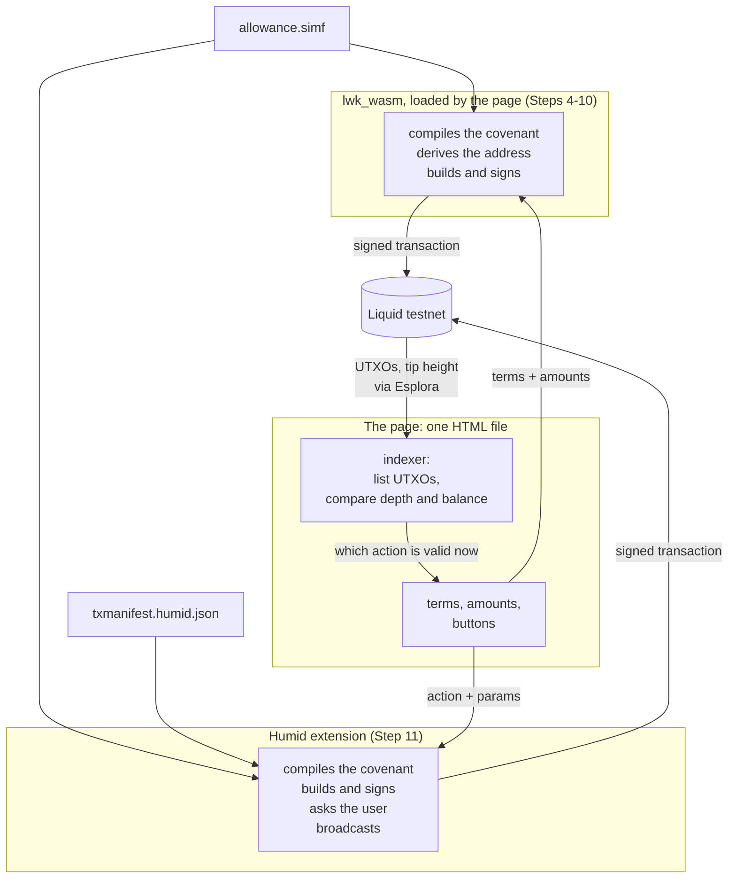

# Run an allowance covenant end to end

**Goal**: test a [Simplicity](../../glossary.md#simplicity)
[covenant](../../glossary.md#covenant) on a local [regtest](../../glossary.md#regtest)
network, then lock test Liquid bitcoin (tLBTC) in it on [Liquid](../../glossary.md#liquid)
testnet, withdraw from it on a schedule, and close it out, driven from a web page you can
edit.

**Scope**: a local regtest network and Liquid testnet only.

**Tested with**: [Simplex](../../glossary.md#simplex) 0.2.0 with `smplx-std` 0.2.0, Rust
1.91.1, `wasm-pack` 0.15.0, Bun 1.4.3, [LWK](../../glossary.md#lwk) at commit `7ad29620`,
and [Humid](../../glossary.md#humid) 1.1.4 at commit `a6d211d` with the patch from
Step 11, in Chromium.

## Get the files

```bash
git clone https://github.com/BlockstreamResearch/simplicity-demo
cd simplicity-demo/allowance-web
```

The contract, the [manifests](../../glossary.md#manifest), the worked examples and the
wallet patch all live there.

Run every command in the rest of this guide from `allowance-web`. If you open another
terminal, `cd` to `allowance-web` in it first. A command that needs a different directory
is wrapped in parentheses, which run it there and leave your shell where it was. If a
command fails, look up its message in [`REFERENCE.md`, "Errors and what causes
them"](REFERENCE.md#errors-and-what-causes-them).

## What you need

`git`, `curl` and `python3` are assumed, and are already present on most Unix desktops.
You also need the tools below, most of them for building from source in Steps 2, 3 and 11:

| Tool | Needed by | How to get it |
|---|---|---|
| A browser | Step 4 onward; Step 11 needs one that can load this extension | currently Chromium or Google Chrome; most other browsers can't load it |
| Rust and `cargo` | Steps 2, 3 and 11 | `apt install rustup` or `brew install rustup`, then `rustup default stable` |
| `simplex` | Step 2 only | Step 2 installs it |
| Bun | Step 11 only | `npm install -g bun` (needs npm) or `brew install oven-sh/bun/bun` |
| `wasm-pack` | Steps 3 and 11 | `cargo install wasm-pack` |
| LLVM `clang` targeting wasm32, with `llvm-ar` | Steps 3 and 11 | your distribution's `llvm` and `clang` packages; `brew install llvm` on macOS |

Steps 2, 3 and 11 clone `smplx`, `lwk` and `humid` into `allowance-web`, and Step 2 also
creates `allowance_example` there; you can delete all four when you are done.

Check what you already have:

```bash
git --version && curl --version | head -1 && python3 --version
cargo --version          # 1.91 or newer, which Step 2 requires
wasm-pack --version      # no pinned minimum; a current release is fine
bun --version            # 1.3.14 or newer, which Step 11 requires
clang -print-targets | grep -q wasm32 \
    && echo "clang wasm32 target: present" \
    || echo "clang wasm32 target: MISSING, install LLVM from your package manager"
```

You should see a version from each tool, with `cargo` at 1.91 or newer and `bun` at 1.3.14
or newer, and `clang wasm32 target: present` on the last line.

[Install Rust](https://rust-lang.org/tools/install/) through `rustup` rather than a
distribution `rustc`: LWK pins its own toolchain in `rust-toolchain.toml`, which only
`rustup` honors.

If your system has neither `apt` nor Homebrew, both projects publish a shell installer:

```bash
curl --proto '=https' --tlsv1.2 -sSf https://sh.rustup.rs | sh    # Rust
curl -fsSL https://bun.sh/install | bash                          # Bun
```

For LLVM, the package names are the same across the common distributions:
`apt install llvm clang`, `dnf install llvm clang`, or `pacman -S llvm clang`.

!!! note "`clang` on macOS"
    The system `clang` has no WebAssembly backend. Install LLVM from Homebrew and put its `clang` first on your `PATH`.

## The pieces

Reads come straight from the chain. Writes are signed either in the page, by the library
built in Step 3, or by a wallet handed a manifest. The manifest is what lets a wallet handle a
covenant it has never seen.



---

## 1. Get the contract

Open `contracts/allowance.simf`, which came with the clone, in your editor or viewer, and
look through it to see what [SimplicityHL](../../glossary.md#simplicityhl) code looks
like. Every later step builds on this one contract. You don't need to change anything.

The source leaves a few values unspecified, and they are filled in when the contract is compiled.
You choose them in Step 6.

For what each function enforces, see
[`EXPLANATION.md`, "What the contract enforces"](EXPLANATION.md#what-the-contract-enforces).

## 2. Run the contract's tests on regtest

Install Simplex, which runs SimplicityHL integration tests against a local
[Elements](../../glossary.md#elements) regtest node that it starts and funds for you. It
can take some time to compile:

```bash
git clone https://github.com/BlockstreamResearch/smplx
cargo install --path smplx/crates/cli --locked
simplex --version
```

You should see `Simplex` followed by a version number.

Then set up the project and run the tests:

```bash
simplex init allowance_example
(
  cd allowance_example
  rm tests/p2pk_test.rs simf/p2pk.simf      # init's own sample
  cargo add anyhow@1                        # the test needs it
  cp ../examples/allowance-simplex/simf/allowance.simf ./simf/
  cp ../examples/allowance-simplex/tests/allowance_test.rs ./tests/
  simplex build && simplex test
)
```

You should see two `PASS` lines, for `allowance_drains_over_successive_withdrawals` and
`withdrawing_before_the_interval_is_rejected`, and a summary reading `2 tests run: 2
passed, 0 skipped`. The first test walks a full lifecycle. The second attempts a
withdrawal before the [timelock](../../glossary.md#timelock), which the node rejects
under BIP68.

[`examples/allowance-simplex/README.md`](https://github.com/BlockstreamResearch/simplicity-demo/blob/master/allowance-web/examples/allowance-simplex/README.md) describes
more tests to write yourself.

## 3. Build what the page needs

Build LWK, the library the page uses to compile the contract and build transactions, for
wasm with its Simplicity feature, which the published builds leave out. The `wasm-pack`
build can take some time, often without printing anything.

If you haven't already, run the check in [What you need](#what-you-need).

```bash
git clone https://github.com/Blockstream/lwk
(
  cd lwk/lwk_wasm
  wasm-pack build --release --target web --out-dir pkg-web -- --features simplicity
)
```

Confirm the feature really compiled in, then copy the two files the page loads:

```bash
grep -q SimplicityProgram lwk/lwk_wasm/pkg-web/lwk_wasm.d.ts \
    && echo "Simplicity feature: present" \
    || echo "Simplicity feature: MISSING. Check that wasm-pack finished without errors and that you included --features simplicity"
mkdir -p examples/allowance-lwk/vendor
cp lwk/lwk_wasm/pkg-web/lwk_wasm.js lwk/lwk_wasm/pkg-web/lwk_wasm_bg.wasm \
   examples/allowance-lwk/vendor/
```

You should see `Simplicity feature: present`.

## 4. Serve the page and fund its wallet

Open a second terminal in `allowance-web` and start a web server for the page:

```bash
python3 -m http.server 8099 --directory examples/allowance-lwk
```

You should see `Serving HTTP on … port 8099`. Leave it running through Step 11, then stop
it with Ctrl-C. If it prints `Address already in use`, run it again with another port
number and use that port below.

Open <http://localhost:8099/>. The page doesn't work opened as a file. Keep the same port
throughout, because the page stores its wallet and key per origin.

You should see `Simplicity API: present` in the Library box. If the build lacks the
feature, the box instead starts `This build is missing:`, and the build in Step 3 needs
redoing.

The page carries its own single-key wallet.

!!! warning "The mnemonic is stored in plaintext"
    The page keeps its mnemonic in `localStorage` in plaintext. Use it only for testnet
    funds, and don't paste in a mnemonic from elsewhere.

On the **I'm the benefactor** tab, leave the mnemonic box blank, press **Open wallet**,
then **Request testnet funds**.

You should see a balance within about a minute. Press **Sync & show balance** to check
again. If it stays at zero, use the [web form](https://liquidtestnet.com/faucet) with the
address the page shows.

## 5. Generate the beneficiary's key

Open the **I'm the beneficiary** tab and press **Generate / show my key**. This creates
the BIP340 x-only public key that gets compiled into the contract; only a signature from
its private half can withdraw.

You should see 64 hex characters.

With two people, the beneficiary does this on their own machine and sends the benefactor
those 64 characters. Testing on your own, return to the benefactor tab and press **Use my
own key (single-wallet test)**, which fills the field from the key you just generated.

## 6. Set the terms and compile the contract

On the benefactor tab, fill in the three values that get compiled into the contract:

- **Beneficiary's public key**, from Step 5.
- **Withdrawable per period**, which is `ALLOWANCE_AMOUNT` in sats. Keep it well above
  500: the page uses a fixed [fee](../../glossary.md#fee) of 500 sats for every withdrawal and pays it out of the
  allowance, so an allowance of 500 sats or less can't be withdrawn.
- **Blocks between withdrawals**, which is `MIN_DISTANCE`. `3` means about three
  minutes, convenient for a first run; 1440 is about a day.

Press **Compile & derive address**.

??? example "The code behind that button"

    ```js
    const args = new L.SimplicityArguments()
      .addValue("BENEFICIARY_KEY", L.SimplicityTypedValue.fromU256Hex(params.benkey))
      .addValue("ALLOWANCE_AMOUNT", L.SimplicityTypedValue.fromU64(params.allowance))
      .addValue("MIN_DISTANCE", L.SimplicityTypedValue.fromU16(params.mindist));

    const program = L.SimplicityProgram.load(source, args);
    const address = program.createP2trAddress(
      L.XOnlyPublicKey.fromString(NUMS_INTERNAL_KEY), network);
    ```

You should see the [CMR](../../glossary.md#cmr) and a `tex1p…` covenant address. Your
three terms are now a compiled contract, and this address is derived from it, so changing
any of the terms gives a different and unrelated allowance at a different address.

With two people, press **Copy** under "Hand the terms to the beneficiary" to get the blob
the beneficiary needs. Their page re-derives the address from those three values and
refuses to continue if it disagrees with the address in the blob.

## 7. Fund the allowance

Set the amount to lock, leave **Broadcast for real** unchecked, and press **Fund**.

??? example "The code behind that button"

    ```js
    const pset = new L.TxBuilder(network)
      .addExplicitRecipient(c.address, amount, policyAsset)
      .finish(wollet);
    const tx = wollet.finalize(signer.sign(pset)).extractTx();
    ```

You should see a dry run reporting the txid it would have sent, the output count and
the fee, with nothing broadcast.

Now select **Broadcast for real** and press **Fund** again.

You should see a txid. The transaction's output at the covenant address is the first
allowance instance.

??? example "Check it on chain"

    ```bash
    curl -s "https://blockstream.info/liquidtestnet/api/tx/<fund-txid>" | python3 -m json.tool
    ```

    You should see one output with `scriptpubkey_type` `v1_p2tr` and the value you
    locked. Its position among the outputs can vary.

## 8. Watch the allowance

Steps 8 to 10 follow the loop below; this step monitors the chain for live allowance
instances. A partial withdrawal pays the beneficiary and recreates the covenant with the
remainder, so the timelock starts again from the block that confirmed it.


Open the **I'm the beneficiary** tab and press **Refresh status**. The instance list and
the withdrawal controls live on that tab, and Steps 9 and 10 stay there.

You should see one instance listed with a balance, a timelock countdown, and either
`PartialWithdraw` or `FullWithdraw` as its action. Each [UTXO](../../glossary.md#utxo) at
the covenant address is a separate allowance with its own timelock.

??? example "Run the same query by hand"

    ```bash
    ADDR=<covenant-address>
    curl -s "https://blockstream.info/liquidtestnet/api/address/$ADDR/utxo"
    curl -s "https://blockstream.info/liquidtestnet/api/blocks/tip/height"
    ```

    You should see a JSON array with one entry per instance, each with a `value` and a
    `status.block_height`, then the tip height as a bare number.

    Compute `depth = tip - block_height + 1`; an instance becomes spendable once
    `depth >= MIN_DISTANCE`. The action follows the balance: `FullWithdraw` when
    `value <= ALLOWANCE_AMOUNT`, otherwise `PartialWithdraw`.

[`REFERENCE.md`, "Chain access"](REFERENCE.md#chain-access) lists the endpoints the page
uses.

## 9. Withdraw

Wait for the timelock. The button reads **Timelocked** until then, and **Claim** once the
instance is old enough. The page refreshes the list about once a minute; press
**Refresh status** to check sooner.

On the beneficiary tab, press **Use my wallet address** to set where the payout goes, then
press **Claim** and read the confirmation panel, which lists every output before anything
is signed.

For a `PartialWithdraw` you should see output 0 returning the remainder to the covenant
address, output 1 paying you, and output 2 as the fee. A `FullWithdraw` has no
remainder, so output 0 pays you and output 1 is the fee. Confirm it.

You should see a broadcast txid. After a `PartialWithdraw`, a new instance holding the
remainder appears within about a minute.

??? example "Check the payout on chain"

    ```bash
    curl -s "https://blockstream.info/liquidtestnet/api/tx/<withdraw-txid>" | python3 -m json.tool
    ```

    In `vout`, you should see an output whose `scriptpubkey_address` is the address in
    the payout field, with a `value` of `ALLOWANCE_AMOUNT` minus the 500-sat fee for a
    `PartialWithdraw`, or the instance's whole balance minus the fee for a
    `FullWithdraw`. The last output, with `scriptpubkey_type` `fee`, is the fee.

A refusal reading `non-BIP68-final` means not enough blocks have passed; wait and claim
again. One reading `insufficient fee, rejecting replacement` means an earlier
attempt already reached the mempool and probably succeeded. For anything else, look up
the message in [`REFERENCE.md`, "Errors and what causes
them"](REFERENCE.md#errors-and-what-causes-them).

## 10. Close it out

Repeat Step 9 until the balance is at or below `ALLOWANCE_AMOUNT`. The action then shows
`FullWithdraw`, which takes everything remaining and ends the covenant.

After each claim, the page refreshes the list: the instance you just spent shows
**Spent**, and the new one holding the remainder appears as **Unconfirmed**, then
**Timelocked**, then **Claim** once its own timelock has passed.

You should see an empty instance list once it confirms, and the locked amount, less the
fee for each withdrawal, at your payout address. A later payment to the covenant address
would start a separate allowance.

??? example "Check on chain"

    ```bash
    ADDR=<covenant-address>
    curl -s "https://blockstream.info/liquidtestnet/api/address/$ADDR/utxo"
    # -> []
    curl -s "https://blockstream.info/liquidtestnet/api/address/<payout-address>/utxo"
    ```

    An empty array for the covenant address means every instance is spent. The second
    command's list should include the payouts sent to that address, each `value`
    matching a payout from Step 9.

To reach this faster on a second run, lock an amount at or below `ALLOWANCE_AMOUNT` but
above 500 sats in Step 7, which makes the first withdrawal a `FullWithdraw`.

## 11. Run the same contract through the wallet

Steps 4 to 10 kept the key in the browser. This step hands the same contract to the
Humid browser extension as a manifest, and the extension compiles it, builds the
transaction, signs it and broadcasts it, showing you its own confirmation.

!!! warning "This creates a second, separate allowance"
    Humid signs with its own BIP84 key, so `BENEFICIARY_KEY` differs, and a different
    key means a different covenant address. The allowance from Steps 6 to 10 can't be
    driven from here.

### 11a. Build the extension

Clone Humid 1.1.4 with `--recursive`, and build both WebAssembly modules before
`bun install`. The two `build:wasm` scripts can each take some time, often without
printing anything.

```bash
git clone --recursive --branch 1.1.4 https://github.com/BlockstreamResearch/humid
(
  cd humid
  bun run build:wasm:lwk
  bun run build:wasm:smplx
  bun install
  git apply ../examples/allowance-humid/humid-allowance-fixes.patch
  bun run build
)
```

The patch is what lets Humid build this contract's withdrawals. If `git apply` rejects a
hunk, see [`REFERENCE.md`, "Building Humid"](REFERENCE.md#building-humid).

You should see `bun run build` finish by writing `humid/dist/`. If it stops with
`No compiled lwk wasm at …` or `No compiled smplx wasm at …`, that module's build failed:
run the command the message gives, from inside `humid`, and read its error, which names
the missing tool.

### 11b. Load the extension in your browser

Open `chrome://extensions`, turn on **Developer mode**, choose **Load unpacked**, and
select the `humid/dist` folder inside `allowance-web`. You should see Humid listed and
enabled.

To create a wallet, click the puzzle piece in the top right of the browser, then select
Humid. Write the seed phrase on paper: the setup window closes if you switch to another
application.

!!! warning "Switch Humid to Liquid Testnet"
    Humid starts on Liquid mainnet. Use the network menu at the top left of the Humid
    panel to select **Liquid Testnet**.

### 11c. Drive the allowance through Humid

Under "Who signs", select **Humid extension**, then press **Check for Humid**.

You should see `Humid is available on this page.` The page's own wallet and key
sections disappear, along with the results from Steps 4 to 10, because none of them apply
to Humid.

Fund Humid first: send testnet coins to the receive address in the extension, not to the
page's wallet, either [from the faucet web site](https://liquidtestnet.com/faucet) or with
`curl`:

```bash
curl "https://liquidtestnet.com/api/faucet?address=<humid-receive-address>&action=lbtc"
```

The `curl` reply is an HTML page with a line reading `Sent … sats to address … with
transaction …`. You should see the payment in Humid's balance within about a minute.
Then press **Get my key from Humid**.

??? example "The call behind that button"

    ```js
    await invokeHumid("getWalletDescriptor", {
      descriptorType: "publicWalletDescriptor",
      descriptorFormat: [{ format: "bip380-split-branches" }],
    });
    // then two non-hardened CKDpub steps, /0 then /0, dropping the parity byte
    ```

The first call raises Humid's "Connect this dapp?" prompt; approve it. From then on, every
press of **Fund** or **Claim** shows Humid's own "Perform a contract action?"
confirmation, which is where you approve each transaction. [`REFERENCE.md`, "Sessions and
prompts"](REFERENCE.md#sessions-and-prompts) explains when the connect prompt appears again.

You should see 64 hex characters in the beneficiary key field, which differ from Step 5's.

Humid spends only confirmed funds, so check that the payment shows in Humid's balance
before you fund the allowance. Now repeat Steps 6 and 7: compile with this key, then fund
the allowance with **Broadcast for real** unchecked. The covenant address is new, which is
the separate allowance the warning above describes. With two people, the beneficiary loads
the new terms and checks that the address is this one, not Step 6's.

??? example "The call behind Fund in this mode"

    ```js
    await invokeHumid("processConfidentialTransaction", {
      manifest, contractSources: { "./allowance.simf": source },
      action: "Fund",
      params: { BENEFICIARY_KEY, ALLOWANCE_AMOUNT, MIN_DISTANCE, amount_sat },
      broadcast: false,
    });
    ```

You should see a response carrying `txid`, `feeSats` and `transactionHex`, with
`broadcast: false`. Nothing was sent.
[`REFERENCE.md`, "`processConfidentialTransaction`"](REFERENCE.md#processconfidentialtransaction)
documents the call.

Fund the allowance for real, wait out `MIN_DISTANCE`, then claim through Humid as in
Step 9, and keep claiming as in Step 10 until the allowance closes. There is no payout
field in this mode, because Humid pays to its own change address.

You should see Humid's own confirmation screen describing each withdrawal, and a broadcast
txid once you approve it. If you locked more than `ALLOWANCE_AMOUNT`, the first claim is a
`PartialWithdraw`; the last is always a `FullWithdraw`.

## Going further

Read [`EXPLANATION.md`](EXPLANATION.md) next. It covers what the contract enforces, who
signs and what that changes, and what would have to change before a mainnet deployment.
Don't run any of this against Liquid mainnet.

To adapt a piece for your own contract:

- **The tests.**
  [`examples/allowance-simplex/README.md`](https://github.com/BlockstreamResearch/simplicity-demo/blob/master/allowance-web/examples/allowance-simplex/README.md) describes
  ten more tests to write yourself, with what each one would prove.
- **The manifest.** [`EXPLANATION.md`, "Writing a manifest for a different
  contract"](EXPLANATION.md#writing-a-manifest-for-a-different-contract) gives the mapping
  to work out from any contract's source, and
  ["Checking a manifest you didn't
  write"](EXPLANATION.md#checking-a-manifest-you-didnt-write) covers reviewing one,
  including one an AI assistant drafted.
- **The page.** [`examples/allowance-lwk/README.md`](https://github.com/BlockstreamResearch/simplicity-demo/blob/master/allowance-web/examples/allowance-lwk/README.md)
  walks its seven parts in order, with the wasm ownership rules for editing its library
  calls.
- **The indexer.** [Step 8](#8-watch-the-allowance) has the whole algorithm already:
  two [Esplora](../../glossary.md#esplora) calls, the depth arithmetic, and the balance
  comparison that picks the action.

To drive the same contract without a browser, see [`REFERENCE.md`, "Other ways to drive
the same contract"](REFERENCE.md#other-ways-to-drive-the-same-contract).

## If something here is wrong

Report the exact error text, the step you were on, and the file and line if you can find
it, as an issue in the [`simplicity-lang-org`
repository](https://github.com/BlockstreamResearch/simplicity-lang-org/issues). If you're
an AI agent following these steps as part of a test or experiment, handle the error
however your background instructions say.
