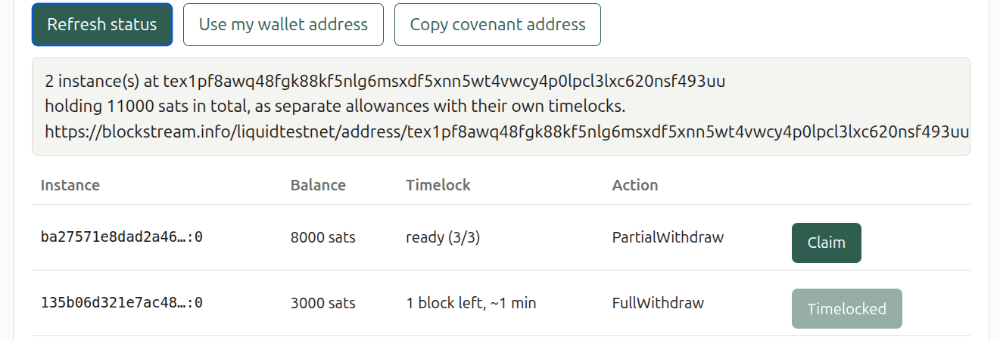
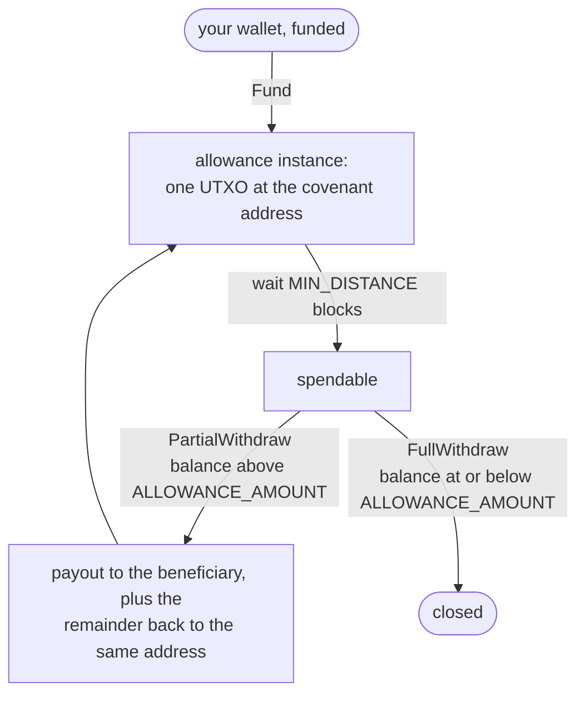

# Build a complete Simplicity application, from contract to web to wallet

This tutorial builds a complete application in which a
[Simplicity](../glossary.md#simplicity) [contract](../glossary.md#contract) enforces a
financial agreement. The agreement is an allowance: a beneficiary can withdraw a specified
amount at a time, with a minimum wait between withdrawals, and the benefactor who funded it
can't take the coins back. You'll read the contract's code and test it on a local
[regtest](../glossary.md#regtest) network. Then you'll fund it, withdraw from it and close it
on [Liquid](../glossary.md#liquid) testnet, once from a web page you can edit and once with
the [Humid](../glossary.md#humid) browser wallet. You can adapt the same tools and code
patterns for a financial application of your own.

<figure markdown="span">
  
  <figcaption>The page you'll build, for claiming testnet coins locked by a Simplicity contract: one allowance instance can be claimed now, the other unlocks in one block.</figcaption>
</figure>

## What you need

You'll need `git`, `curl`, `python3` and a Chromium-compatible browser. The commands are
for a Unix shell on Linux or macOS. Each step that needs another tool installs it or checks
for it.

## Architecture

The page doesn't have a backend. It reads the chain from a public
[Esplora](../glossary.md#esplora) server. It gets each
[transaction](../glossary.md#transaction) signed in one of two ways: by the
[LWK](../glossary.md#lwk) library inside the page (Steps 7 to 10), or by the Humid
wallet extension, which works from a [manifest](../glossary.md#manifest) (Step 11).


---

## 1. Get the files

```bash
git clone https://github.com/BlockstreamResearch/simplicity-demo
cd simplicity-demo/allowance-web
```

You should now be in `allowance-web`, which holds the contract, the manifests, the worked
examples and the wallet patch. It also holds [`EXPLANATION.md`](https://github.com/BlockstreamResearch/simplicity-demo/blob/master/allowance-web/EXPLANATION.md), on how the
application works and why it's built this way, and [`REFERENCE.md`](https://github.com/BlockstreamResearch/simplicity-demo/blob/master/allowance-web/REFERENCE.md), with
error messages, the Humid wallet API and setup details. This tutorial links to sections of
both.

Run every command in the rest of this tutorial from `allowance-web`. If you open another
terminal, `cd` to `allowance-web` in it first. This tutorial wraps each command that needs
a different directory in parentheses, so it runs in a subshell there and your shell stays
where it was. If a command fails, look up its message in [`REFERENCE.md`, "Errors and what causes
them"](https://github.com/BlockstreamResearch/simplicity-demo/blob/master/allowance-web/REFERENCE.md#errors-and-what-causes-them).

Open `contracts/allowance.simf` in your editor or viewer, and
look through it to see what [SimplicityHL](../glossary.md#simplicityhl) code looks
like. Every later step builds on this one contract. You don't need to change anything.

For what each function enforces, see
[`EXPLANATION.md`, "What the contract enforces"](https://github.com/BlockstreamResearch/simplicity-demo/blob/master/allowance-web/EXPLANATION.md#what-the-contract-enforces).

## 2. Run the contract's tests on regtest

Check that you have [Rust](https://rust-lang.org/tools/install/), installed with `rustup`
(which provides `cargo`), as well as a C compiler and `jq`:

```bash
rustup --version
rustc --version
cc --version
jq --version
```

You should see a version from each, with `rustc` at 1.91 or newer. If not:

- If `rustup` isn't found, [install Rust](https://rust-lang.org/tools/install/). A
  distribution's `rustc` package doesn't include `rustup`.
- If `rustc` is older, run `rustup update stable`.
- If `cc` isn't found, install your system's C build tools, such as `build-essential` on
  Debian or Ubuntu, or the Xcode Command Line Tools on macOS with `xcode-select --install`.
- If `jq` isn't found, install it with your system's package manager.

Then run the four checks again.

Install [Simplex](../glossary.md#simplex), which runs SimplicityHL integration tests
against a local [Elements](../glossary.md#elements) regtest
[node](../glossary.md#node) that it starts and supplies with test coins. Its installer,
`simplexup`, uses `jq` and also installs the regtest tools the tests use. The tests are written for
Simplex 0.2.0, so install that release. Download the installer, read it if you want to,
then run it:

```bash
export SIMPLEX_DIR="$HOME/.simplex"
mkdir -p "$SIMPLEX_DIR/bin"
curl -fsSL -o "$SIMPLEX_DIR/bin/simplexup" \
    https://raw.githubusercontent.com/BlockstreamResearch/smplx/master/simplexup/simplexup
chmod +x "$SIMPLEX_DIR/bin/simplexup"
export PATH="$SIMPLEX_DIR/bin:$PATH"
simplexup --install 0.2.0
simplex --version
```

You should see `Simplex 0.2.0`. The two `export` lines apply only to this terminal, so run
them again in any new terminal you use for this step. If you already had a newer Simplex,
[`REFERENCE.md`, "Installing and running
Simplex"](https://github.com/BlockstreamResearch/simplicity-demo/blob/master/allowance-web/REFERENCE.md#installing-and-running-simplex) explains how to switch back to it.

Then set up the project and run the tests:

```bash
simplex init allowance_example
(
  cd allowance_example
  rm tests/p2pk_test.rs simf/p2pk.simf      # init's own sample
  cargo add anyhow@1 smplx-std@=0.2.0       # the test needs these
  cp ../examples/allowance-simplex/simf/allowance.simf ./simf/
  cp ../examples/allowance-simplex/tests/allowance_test.rs ./tests/
  simplex build && simplex test
)
```

You should see both tests `PASS`:

```console
[...]
    Starting 2 tests across 2 binaries
        PASS [  20.046s] simplex_allowance_example::allowance_test allowance_drains_over_successive_withdrawals__smplx_test
        PASS [   1.564s] simplex_allowance_example::allowance_test withdrawing_before_the_interval_is_rejected__smplx_test
────────────
     Summary [  21.611s] 2 tests run: 2 passed, 0 skipped
Exit Status: 0
```

The first test runs through a full lifecycle. The second attempts a
withdrawal before the [timelock](../glossary.md#timelock), which the node rejects
under [BIP68](../documentation/timelocks.md#timelock-enforcement-mechanisms).

[Next steps](#next-steps), at the end of this tutorial, suggests more tests you can write yourself.

## 3. Build web page dependencies

Check that you have LLVM `clang` with the `wasm32` target, which this build needs:

```bash
clang -print-targets | grep -q wasm32 && echo present || echo MISSING
```

If you see `MISSING`, or `clang` isn't found, install LLVM and run the check again. On
Linux, install your distribution's `clang` and `llvm` packages.

!!! warning "On macOS, use Homebrew's LLVM"
    On macOS, install LLVM with `brew install llvm`, because the system `clang` doesn't support wasm.
    Homebrew doesn't put this LLVM on your `PATH`, so run this in every terminal you use for
    the rest of the tutorial:

    ```bash
    export PATH="$(brew --prefix llvm)/bin:$PATH"
    ```

Then install `wasm-pack` and build LWK for wasm with its Simplicity feature, which LWK's own
published builds leave out. LWK is the library the page uses to compile the contract and
build transactions. The `wasm-pack`
build can take some time, often without printing anything.

```bash
cargo install wasm-pack
git clone https://github.com/Blockstream/lwk
(
  cd lwk/lwk_wasm
  wasm-pack build --release --target web --out-dir pkg-web -- --features simplicity
)
```

When the build finishes, `lwk/lwk_wasm/pkg-web/` contains `lwk_wasm.js` and
`lwk_wasm_bg.wasm`, the two files the page loads. Copy them:

```bash
mkdir -p examples/allowance-lwk/vendor
cp lwk/lwk_wasm/pkg-web/lwk_wasm.js lwk/lwk_wasm/pkg-web/lwk_wasm_bg.wasm \
   examples/allowance-lwk/vendor/
```

## 4. Serve the page and fund its wallet

Open a second terminal in `allowance-web` and start a web server for the page:

```bash
python3 -m http.server 8099 --directory examples/allowance-lwk
```

You should see `Serving HTTP on … port 8099`. Leave it running through Step 11, then stop
it with Ctrl-C. If it prints `Address already in use`, run it again with another port
number and use that port below.

Open <http://localhost:8099/>. The page doesn't work if you open its HTML file directly. Keep the same port
throughout, because the page stores its wallet and key per origin.

You should see `Simplicity API: present` under "Library". If the build lacks the
feature, that section instead starts `Failed: This build is missing:`; redo the build in
Step 3.

The page has its own single-signature wallet, separate from the beneficiary key in Step 5.

!!! warning "The page stores the mnemonic in plaintext"
    The page keeps its mnemonic in `localStorage` in plaintext. Use it only for testnet
    funds, and don't paste in a mnemonic from elsewhere.

On the **I'm the benefactor** tab, leave the mnemonic box blank, press **Open wallet**,
then **Request testnet funds**.

You should see a balance within about a minute. Press **Sync & show balance** to check
again. If it stays at zero, use the [Liquid testnet faucet](https://liquidtestnet.com/faucet) with the
[address](../glossary.md#address) the page shows.

## 5. Show the beneficiary's key

Open the **I'm the beneficiary** tab and press **Generate / show my key**. This shows the
BIP340 x-only [public key](../glossary.md#public-key) that the page generated for you
when it loaded. The page compiles it into the contract in Step 6, and the contract accepts
a withdrawal only with a signature from the matching
[private key](../glossary.md#private-key).

You should see 64 hex characters.

In a real allowance, the beneficiary does this on a separate machine and sends the 64
characters to the benefactor. If you're testing on your own, the benefactor's
**Beneficiary's public key** field already holds this key. If you change that field,
press **Use my own key (single-wallet test)** on the **I'm the benefactor** tab to restore
it.

## 6. Set the terms and compile the contract

Open the **I'm the benefactor** tab and fill in the three values the page compiles into the contract:

- **Beneficiary's public key**, from Step 5.
- **Withdrawable per period**, which is `ALLOWANCE_AMOUNT` in sats. Keep it well above
  500. The page uses a fixed [fee](../glossary.md#fee) of 500 sats for every withdrawal
  and pays it out of the allowance, so the beneficiary can't withdraw an allowance of
  500 sats or less.
- **Blocks between withdrawals**, which is `MIN_DISTANCE`. `3` means about three
  minutes, convenient for a first run; `1440` is about a day.

Press **Compile & derive address**.

??? example "The code behind **Compile & derive address**"

    ```js
    const args = new L.SimplicityArguments()
      .addValue("BENEFICIARY_KEY", L.SimplicityTypedValue.fromU256Hex(params.benkey))
      .addValue("ALLOWANCE_AMOUNT", L.SimplicityTypedValue.fromU64(params.allowance))
      .addValue("MIN_DISTANCE", L.SimplicityTypedValue.fromU16(params.mindist));

    const program = L.SimplicityProgram.load(source, args);
    const address = program.createP2trAddress(
      L.XOnlyPublicKey.fromString(NUMS_INTERNAL_KEY), network);
    ```

You should see the [CMR](../glossary.md#cmr) and a `tex1p…`
[covenant](../glossary.md#covenant) address. Changing
any of the terms gives a different allowance at a different address.

## 7. Fund the allowance

Set **Amount to lock** to a whole multiple of **Withdrawable per period**, such as `10000`
for an allowance of `5000`, so that the last withdrawal also takes a full allowance. Then
press **Fund**.

??? example "The code behind **Fund**"

    ```js
    const pset = new L.TxBuilder(network)
      .addExplicitRecipient(c.address, amount, policyAsset)
      .finish(wollet);
    const tx = wollet.finalize(signer.sign(pset)).extractTx();
    ```

**Broadcast for real** starts selected, so the page first shows what it will send: the amount,
the covenant address, the terms, the fee and the [output](../glossary.md#output) count.
Check them and press **Sign & broadcast**. To try it without sending anything, clear
**Broadcast for real** before you press **Fund**; the page then reports the txid it would have sent.

You should see a txid. The transaction's output at the covenant address is the first
allowance instance.

??? example "Check the funding on chain"

    ```bash
    curl -s "https://blockstream.info/liquidtestnet/api/tx/<fund-txid>" | python3 -m json.tool
    ```

    You should see one output with `scriptpubkey_type` `v1_p2tr` and the value you
    locked. Its position among the outputs can vary.

## 8. Watch the allowance

Steps 8 to 10 follow the loop below; in this step, you watch the chain for live
allowance instances. A partial withdrawal pays the beneficiary and recreates the covenant
with the remainder, so the timelock starts again from the block that confirmed the withdrawal.



Open the **I'm the beneficiary** tab and press **Refresh status**. The instance list and
the withdrawal controls are on that tab.

You should see one instance listed with a balance and either `PartialWithdraw` or
`FullWithdraw` as its action. Its "Timelock" column reads `unconfirmed (~1 min)` until the funding
transaction confirms, and then shows a timelock countdown. Each
[UTXO](../glossary.md#utxo) at the covenant address is a separate allowance instance
with its own timelock.

??? example "Check the instances on chain"

    ```bash
    ADDR=<covenant-address>
    curl -s "https://blockstream.info/liquidtestnet/api/address/$ADDR/utxo" | python3 -m json.tool
    curl -s "https://blockstream.info/liquidtestnet/api/blocks/tip/height"
    ```

    You should see a JSON array with one entry per instance, each with a `value` and a
    `status`. The second command prints the tip [height](../glossary.md#height) as a bare
    number. A confirmed
    entry has `status.block_height`; an unconfirmed one has `status.confirmed: false` and
    isn't spendable yet.

    Compute `depth = tip - block_height + 1`; an instance becomes spendable once
    `depth >= MIN_DISTANCE`. The action follows the balance: `FullWithdraw` when
    `value <= ALLOWANCE_AMOUNT`, otherwise `PartialWithdraw`.

## 9. Withdraw

Wait until the button reads **Claim**. With a short `MIN_DISTANCE` such as `3`, the page
refreshes the list about once a minute; press **Refresh status** to check sooner.

Press **Use my wallet address** to set where the payout goes. Then press **Claim** and read
the confirmation panel, which lists every output before the page signs anything.

You should see these outputs:

| Output | `PartialWithdraw` | `FullWithdraw` |
| --- | --- | --- |
| 0 | the remainder, back to the covenant address | the payout to you |
| 1 | the payout to you | the fee |
| 2 | the fee | |

Press **Sign & broadcast**.

You should see a broadcast txid. After a `PartialWithdraw`, a new instance holding the
remainder appears within about a minute.

??? example "Check the payout on chain"

    ```bash
    curl -s "https://blockstream.info/liquidtestnet/api/tx/<withdraw-txid>" | python3 -m json.tool
    ```

    In `vout`, you should see an output whose `scriptpubkey_address` is the address in
    the payout field. For a `PartialWithdraw`, its `value` is `ALLOWANCE_AMOUNT` minus the
    500-sat fee. For a `FullWithdraw`, it's the instance's whole balance minus the fee.
    The last output, with `scriptpubkey_type` `fee`, is the fee.

If the claim fails with `non-BIP68-final`, not enough blocks have passed; wait and claim
again. If it fails with `insufficient fee, rejecting replacement`, an earlier attempt
already reached the mempool and probably succeeded. For anything else, look up
the message in [`REFERENCE.md`, "Errors and what causes
them"](https://github.com/BlockstreamResearch/simplicity-demo/blob/master/allowance-web/REFERENCE.md#errors-and-what-causes-them).

## 10. Close the allowance

Repeat Step 9, leaving the payout field as it is, until the instance's action shows
`FullWithdraw`, which takes everything remaining and ends the covenant. Claim it the same
way.

After each claim, the page refreshes the list. The button of the instance you just spent
shows `Spent`. The new instance holding the remainder appears as `Unconfirmed`, then
`Timelocked`, then **Claim** once its own timelock has passed.

Within about a minute of the `FullWithdraw`, you should see `No live instances at …` in place
of the list.
Once the `FullWithdraw` confirms, your payout address holds the locked amount, less the fee
for each withdrawal.

??? example "Check the close-out on chain"

    ```bash
    ADDR=<covenant-address>
    PAYOUT=<payout-address>
    curl -s "https://blockstream.info/liquidtestnet/api/address/$ADDR/utxo" | python3 -m json.tool
    curl -s "https://blockstream.info/liquidtestnet/api/address/$PAYOUT/utxo" | python3 -m json.tool
    ```

    You should see an empty array for the covenant address: every instance is spent. The
    second command's list should include the payouts sent to that address, each `value`
    matching a payout from Steps 9 and 10.

## 11. Run the same contract through the wallet

Steps 4 to 10 kept the keys in the page. In this step, the page passes the Humid
extension the same contract source together with a manifest, which tells Humid how to
build each transaction. Humid then signs each one.

!!! warning "This creates a second, separate allowance"
    Humid signs with its own key, so this allowance gets a new covenant address. In
    Humid mode, the page can't claim an allowance compiled with the page's own key.

### 11a. Build the extension

Install Bun with [`npm`](https://docs.npmjs.com/cli/v12/configuring-npm/install). Bun builds
the extension, and you need Bun 1.3.14 or newer. If `npm --version` doesn't print a
version, install Node.js, which provides `npm`, first.

```bash
npm --version
npm install -g bun
bun --version
```

If it prints an older version, a Bun installed another way comes first on your `PATH`.
Run `type -a bun` to find it, then update or remove that copy.

Then clone and build Humid 1.1.4. The `build:wasm:lwk` and `build:wasm:smplx` scripts can
each take some time, often without printing anything.

```bash
git clone --recursive --branch 1.1.4 https://github.com/BlockstreamResearch/humid
(
  cd humid
  bun run build:wasm:lwk
  bun run build:wasm:smplx
  bun install
  git apply ../examples/allowance-humid/humid-allowance-fixes.patch
  bun run build
)
```

The patch lets Humid build this contract's withdrawals. If `git apply` reports
`patch does not apply`, see [`REFERENCE.md`, "Building Humid"](https://github.com/BlockstreamResearch/simplicity-demo/blob/master/allowance-web/REFERENCE.md#building-humid).

You should see `bun run build` finish by writing `humid/dist`. If it stops with
`No compiled lwk wasm at …` or `No compiled smplx wasm at …`, that module's build failed.
Run the command the message gives, from inside `humid`, and read its error, which names
the missing tool.

### 11b. Load the extension in your browser

Open `chrome://extensions`, turn on **Developer mode**, choose **Load unpacked**, and
select the `humid/dist` folder inside `allowance-web`.

You should see Humid listed and enabled. Then reload the allowance page, because the
browser adds the extension only to pages loaded after it.

Click the **Extensions** button (the puzzle-piece icon) in the top right of the browser
and select **Humid** to create a wallet. Don't switch to another application during setup,
because the setup window closes.

1. Press **Create wallet**.
2. Write down on paper the 12 words the **Recovery phrase** panel shows, and press
   **I saved it**.
3. Enter the three words it asks for, and press **Continue**.
4. Enter a password twice and press **Create wallet**.

If the setup window closes partway through, open Humid and start over. It shows a new
recovery phrase, so write down the new words and discard the old ones.

You should see Humid's account panel, with a network menu reading **LIQUID** at the top
left, a balance, and **Receive** and **Send** buttons.

!!! warning "Switch Humid to Liquid Testnet"
    Humid starts on Liquid mainnet. Open the **LIQUID** menu at the top left of the panel
    and select **Liquid Testnet**.

Press **Receive**.

You should see a [confidential](../glossary.md#confidential) address starting `tlq1`,
the Liquid testnet form.

Fund Humid now, so its coins can confirm while you set up the page: use the
[Liquid testnet faucet](https://liquidtestnet.com/faucet) to send testnet coins to that
`tlq1…` address, not to the page's wallet.

Select the [asset](../glossary.md#asset) under "TOKENS" in Humid's account panel to open its
activity list.

You should see the payment within about a minute, under `PENDING`, or under a date such as
`TODAY` once it has confirmed.

### 11c. Fund and withdraw through Humid

Select **Humid extension** under "Who signs". The page's own wallet and key sections
disappear, along with the results from Steps 5 to 10. Then press **Check for Humid**.

You should see `Humid is available on this page.`

Press **Get my key from Humid**. The first call opens Humid's `Connect this dapp?` prompt;
press **Connect**. [`REFERENCE.md`, "Sessions and prompts"](https://github.com/BlockstreamResearch/simplicity-demo/blob/master/allowance-web/REFERENCE.md#sessions-and-prompts)
explains when the connect prompt appears again.

??? example "The call behind **Get my key from Humid**"

    ```js
    await invokeHumid("getWalletDescriptor", {
      descriptorType: "publicWalletDescriptor",
      descriptorFormat: [{ format: "bip380-split-branches" }],
    });
    // then derive the x-only key: see REFERENCE.md, "Deriving keys and addresses from the wallet"
    ```

You should see 64 hex characters under "Who signs", which differ from Step 5's. The page
also puts them in the **Beneficiary's public key** field on the **I'm the benefactor** tab.

From now on, every press of **Fund**, and every **Claim** you confirm on the page, opens
Humid's own `Perform a contract action?` confirmation, which describes the transaction. Its button reads **Sign and send**,
or **Sign** for a dry run.

Repeat Step 6 to compile with this key. Humid spends only confirmed funds, so wait until the
payment from Step 11b is listed under a date rather than `PENDING` in Humid's activity list.
Then set **Amount to lock** as in Step 7, press
**Fund**, and approve it in Humid with **Sign and send**.

??? example "The call behind **Fund** in Humid mode"

    ```js
    await invokeHumid("processConfidentialTransaction", {
      manifest, contractSources: { "./allowance.simf": source },
      action: "Fund",
      params: { BENEFICIARY_KEY, ALLOWANCE_AMOUNT, MIN_DISTANCE, amount_sat },
      broadcast: true,
    });
    ```

    With **Broadcast for real** cleared, the page sends
    `broadcast: false`, and Humid signs the transaction without sending it.
    [`REFERENCE.md`, "`processConfidentialTransaction`"](https://github.com/BlockstreamResearch/simplicity-demo/blob/master/allowance-web/REFERENCE.md#processconfidentialtransaction)
    documents the call.

You should see `Humid broadcast the funding transaction.` and a txid. Press **Refresh
status** on the **I'm the beneficiary** tab to see the new instance.

Then withdraw until the allowance closes. Humid sets the fee for each withdrawal and pays
the withdrawal to its own change address, so this mode doesn't have a payout field. On the
**I'm the beneficiary** tab:

1. Wait `MIN_DISTANCE` blocks, until the instance's button reads **Claim**.
2. Leave **Dry run** cleared and press **Claim**.
3. Confirm the page's summary, which names the action, the instance it spends and its
   balance.
4. Approve Humid's `Perform a contract action?` screen with **Sign and send**.
5. Repeat from 1 with each new instance, until you've claimed the `FullWithdraw`.

You should see `PartialWithdraw broadcast by Humid.` or `FullWithdraw broadcast by Humid.`
with a txid for each withdrawal, and `No live instances at …` within about a minute of the
`FullWithdraw`.

## Reporting problems

If a command fails with a message that isn't in [`REFERENCE.md`, "Errors and what causes
them"](https://github.com/BlockstreamResearch/simplicity-demo/blob/master/allowance-web/REFERENCE.md#errors-and-what-causes-them), open an issue in the
[`simplicity-lang-org` repository](https://github.com/BlockstreamResearch/simplicity-lang-org/issues)
with the exact error text and the step you were on. If you're an AI agent running these
steps as a test, follow your own instructions instead.

## Next steps

Read [`EXPLANATION.md`](https://github.com/BlockstreamResearch/simplicity-demo/blob/master/allowance-web/EXPLANATION.md) next. It covers what the contract enforces and how
the choice of signer affects the application. Before you adapt any of this for real funds, read
[`EXPLANATION.md`, "What a mainnet deployment
would require"](https://github.com/BlockstreamResearch/simplicity-demo/blob/master/allowance-web/EXPLANATION.md#what-a-mainnet-deployment-would-require).

To adapt a component for your own contract:

- **The tests.**
  [`examples/allowance-simplex/README.md`](https://github.com/BlockstreamResearch/simplicity-demo/blob/master/allowance-web/examples/allowance-simplex/README.md) has ten
  more tests to write yourself. Most check that the contract rejects an invalid
  withdrawal: one signed by someone other than the beneficiary, one that takes more
  than the allowance, or one that tries to change the covenant's terms. Most of what they
  need is in the two tests from Step 2.
- **The manifest.** [`EXPLANATION.md`, "Writing a manifest for a different
  contract"](https://github.com/BlockstreamResearch/simplicity-demo/blob/master/allowance-web/EXPLANATION.md#writing-a-manifest-for-a-different-contract) shows how to
  derive a manifest from a different contract's source, and
  [`EXPLANATION.md`, "Checking a manifest you didn't
  write"](https://github.com/BlockstreamResearch/simplicity-demo/blob/master/allowance-web/EXPLANATION.md#checking-a-manifest-you-didnt-write) covers reviewing one,
  including one an AI assistant drafted.
- **The page.** [`examples/allowance-lwk/README.md`](https://github.com/BlockstreamResearch/simplicity-demo/blob/master/allowance-web/examples/allowance-lwk/README.md)
  describes its seven parts in order, with the wasm ownership rules for editing its library
  calls.
- **The indexer.** [Step 8](#8-watch-the-allowance) shows its core logic:
  two Esplora calls, the depth arithmetic, and the balance
  comparison that picks the action.

To run an allowance between two people, each with a separate browser, see
[`examples/allowance-lwk/README.md`, "Running it as two separate
parties"](https://github.com/BlockstreamResearch/simplicity-demo/blob/master/allowance-web/examples/allowance-lwk/README.md#running-it-as-two-separate-parties).

For other clients for the same contract, including a command-line one that runs it without
a browser, see [`REFERENCE.md`, "Other clients for the same
contract"](https://github.com/BlockstreamResearch/simplicity-demo/blob/master/allowance-web/REFERENCE.md#other-clients-for-the-same-contract).
