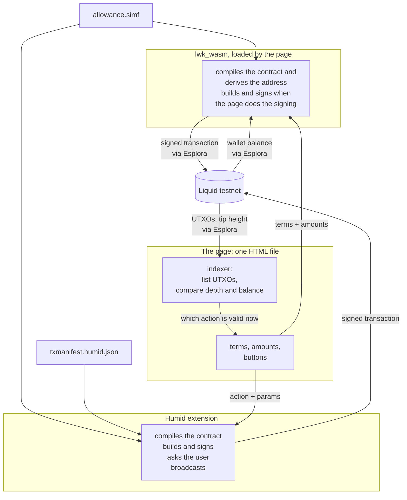

# Build a complete Simplicity application, from contract to web to wallet

This tutorial connects every part of a [Simplicity](../glossary.md#simplicity) application: a
Simplicity [contract](../glossary.md#contract), tests that
run it on a local [regtest](../glossary.md#regtest) network, and a web page that compiles
the contract, reads [Liquid](../glossary.md#liquid) testnet, and has the user's keys sign
each [transaction](../glossary.md#transaction). You'll build each part and use them
together on Liquid testnet, signing first with keys the page holds and then with the
[Humid](../glossary.md#humid) browser wallet. You can adapt the same tools and code
patterns for an application of your own.

The example contract is an allowance: a beneficiary can withdraw up to a specified amount
at a time, with a minimum wait between withdrawals, and the benefactor who funded it can't
take the coins back.

<figure markdown="span">
  
  <figcaption>The page you'll build, for claiming testnet coins locked by a Simplicity contract: one allowance instance can be claimed now, the other unlocks in one block.</figcaption>
</figure>

## Architecture

At run time, the application has four components:

- **The contract,** `allowance.simf`, written in [SimplicityHL](../glossary.md#simplicityhl).
  The page and Humid both compile it from source, with the allowance's terms filled in.
- **The web page,** a single HTML file that you serve locally. It holds the allowance's
  terms, the amounts and the buttons. Its indexer lists the allowance's
  [UTXOs](../glossary.md#utxo), which it reads from a public
  [Esplora](../glossary.md#esplora) server over HTTP, and decides which action is valid
  for each one.
- **The [LWK](../glossary.md#lwk) library,** compiled to WebAssembly and loaded by the
  page. It compiles the contract and derives its [address](../glossary.md#address). When
  the page does the signing, LWK also builds and signs each transaction: the funding with
  the page's own wallet, and each withdrawal with the beneficiary key the page holds. The
  page broadcasts each one through Esplora.
- **The Humid wallet,** a browser extension. The page calls it through the
  `window.humid` object that Humid adds to the page, passing the contract source, a
  [manifest](../glossary.md#manifest) that tells Humid how to build each transaction, and
  the action to perform with the values it needs. Humid compiles the contract, builds the transaction, asks
  the user to approve it, signs it and broadcasts it.



---

## 1. Clone the example repository

The commands in this tutorial are for a Unix shell on Linux or macOS.

```bash
git clone https://github.com/BlockstreamResearch/simplicity-demo
cd simplicity-demo/allowance-web
```

`allowance-web` holds the contract, the page and two pages this tutorial links to:
[`EXPLANATION.md`](https://github.com/BlockstreamResearch/simplicity-demo/blob/master/allowance-web/EXPLANATION.md), on how the application works, and
[`REFERENCE.md`](https://github.com/BlockstreamResearch/simplicity-demo/blob/master/allowance-web/REFERENCE.md), with error messages and the Humid wallet API.

Run every command in the rest of this tutorial from `allowance-web`. If you open another
terminal, `cd` to `allowance-web` in it first. A command block that changes to another
directory ends by changing back. If a command fails, look up its message in
[`REFERENCE.md`, "Errors and what causes them"](https://github.com/BlockstreamResearch/simplicity-demo/blob/master/allowance-web/REFERENCE.md#errors-and-what-causes-them).

Open `contracts/allowance.simf` in your editor or viewer, and look through it to see what
SimplicityHL code looks like. Every later step builds on
this one contract, and you don't need to change it.
[`EXPLANATION.md`, "What the contract enforces"](https://github.com/BlockstreamResearch/simplicity-demo/blob/master/allowance-web/EXPLANATION.md#what-the-contract-enforces)
walks through what each of its checks enforces.

## 2. Test that the contract enforces its terms on regtest

Before you put any coins in the contract, check that you have Rust, installed with
`rustup`:

```bash
rustup --version   # any version; Rust's own installer provides rustup
rustc --version    # 1.91 or newer; if older, run: rustup update stable
```

If `rustup` isn't found, [install Rust](https://rust-lang.org/tools/install/).

Install [Simplex](../glossary.md#simplex), which runs SimplicityHL integration tests
against a local [Elements](../glossary.md#elements) regtest
[node](../glossary.md#node) that it starts and supplies with test coins. Its installer,
`simplexup`, also installs the regtest tools the tests use. The tests are written for
Simplex 0.2.0, so install that release. Download the installer, read it if you want to,
then run it:

```bash
export SIMPLEX_DIR="$HOME/.simplex"   # in a new terminal, run both exports again
mkdir -p "$SIMPLEX_DIR/bin"
curl -fsSL -o "$SIMPLEX_DIR/bin/simplexup" \
    https://raw.githubusercontent.com/BlockstreamResearch/smplx/master/simplexup/simplexup
chmod +x "$SIMPLEX_DIR/bin/simplexup"
export PATH="$SIMPLEX_DIR/bin:$PATH"
simplexup --install 0.2.0
simplex --version   # Simplex 0.2.0
```

If you already had a newer Simplex,
[`REFERENCE.md`, "Installing and running
Simplex"](https://github.com/BlockstreamResearch/simplicity-demo/blob/master/allowance-web/REFERENCE.md#installing-and-running-simplex) explains how to switch back to it.

Then set up the project and run the tests:

```bash
simplex init allowance_example
cd allowance_example
rm tests/p2pk_test.rs simf/p2pk.simf      # init's own sample
cargo add anyhow@1 smplx-std@=0.2.0       # the test needs these
cp ../examples/allowance-simplex/simf/allowance.simf ./simf/
cp ../examples/allowance-simplex/tests/allowance_test.rs ./tests/
simplex build && simplex test
cd ..
```

You should see both tests `PASS`:

```console
[...]
    Starting 2 tests across 2 binaries
        PASS [  20.046s] simplex_allowance_example::allowance_test allowance_drains_over_successive_withdrawals__smplx_test
        PASS [   1.564s] simplex_allowance_example::allowance_test withdrawing_before_the_interval_is_rejected__smplx_test
────────────
     Summary [  21.611s] 2 tests run: 2 passed, 0 skipped
Exit Status: 0
```

If a test shows `FAIL`, check that `allowance_example/Cargo.toml` has
`smplx-std = "=0.2.0"` and that the two files copied into `allowance_example` are unchanged,
then see [Reporting problems](#reporting-problems).

The first test runs through a full lifecycle. The second attempts a
withdrawal before the [timelock](../glossary.md#timelock), which the node rejects
under [BIP68](../documentation/timelocks.md#timelock-enforcement-mechanisms).

[Next steps](#next-steps), at the end of this tutorial, suggests more tests you can write yourself.

## 3. Build the library the page uses to compile and sign

Check that LLVM `clang` has the `wasm32` target, which the LWK build needs:

```bash
clang -print-targets | grep -q wasm32 && echo present || echo MISSING
```

If you see `MISSING`, or `clang` isn't found, install LLVM and run the check again. On
Linux, install your distribution's `clang` and `llvm` packages.

??? warning "On macOS, use Homebrew's LLVM"
    On macOS, install LLVM with `brew install llvm`, because the system `clang` doesn't support wasm.
    Homebrew doesn't put this LLVM on your `PATH`, so run this in every terminal you use for
    the rest of the tutorial:

    ```bash
    export PATH="$(brew --prefix llvm)/bin:$PATH"
    ```

Then install `wasm-pack` and build LWK with its Simplicity feature, which LWK's published
builds leave out. The block checks out the LWK commit the page is written for, since
LWK's Simplicity API can change from one commit to the next. The `wasm-pack` build can
take some time, often without printing anything.

```bash
cargo install wasm-pack
git clone https://github.com/Blockstream/lwk
cd lwk
git checkout 6412ff6bfd823a0cd36d4d07d2f5aee01d6c9c01
cd lwk_wasm
wasm-pack build --release --target web --out-dir pkg-web -- --features simplicity
cd ../..
```

When the build finishes, `lwk/lwk_wasm/pkg-web/` contains `lwk_wasm.js` and
`lwk_wasm_bg.wasm`, the two files the page loads. Copy them:

```bash
mkdir -p examples/allowance-lwk/vendor
cp lwk/lwk_wasm/pkg-web/lwk_wasm.js lwk/lwk_wasm/pkg-web/lwk_wasm_bg.wasm \
   examples/allowance-lwk/vendor/
```

## 4. Serve the page and fund its wallet

Open a second terminal in `allowance-web` and start a web server for the page:

```bash
python3 -m http.server 8099 --directory examples/allowance-lwk
```

You should see `Serving HTTP on … port 8099`. Leave it running until you finish the
tutorial, then stop it with Ctrl-C. If it prints `Address already in use`, run it again with another port
number and use that port below.

Open [http://localhost:8099/](http://localhost:8099/){target="_blank"} in a Chromium-compatible browser, such as Chrome, because
the [Humid extension](#11-set-up-a-browser-wallet-to-sign-instead-of-the-page) that you'll use
later runs only in one. The page doesn't work if you open its HTML file directly. Keep the same port
throughout, because the page stores its wallet and key per origin.

You should see `Simplicity API: present` under "Library". If the build lacks the
feature, that section instead starts `Failed: This build is missing:`; redo the
[LWK build](#3-build-the-library-the-page-uses-to-compile-and-sign).

The page has its own single-signature wallet, separate from the
[beneficiary's key](#5-get-the-beneficiary-key-that-authorizes-withdrawals).

!!! warning "The page stores the mnemonic in plaintext"
    The page keeps its mnemonic in `localStorage` in plaintext. Use it only for testnet
    funds, and don't paste in a mnemonic from elsewhere.

On the **I'm the benefactor** tab, leave the mnemonic box blank, press **Open wallet**,
then **Request testnet funds**.

You should see a balance within about a minute. Press **Sync & show balance** to check
again. If it stays at zero, use the [Liquid testnet faucet](https://liquidtestnet.com/faucet) with the
address the page shows.

## 5. Get the beneficiary key that authorizes withdrawals

Open the **I'm the beneficiary** tab and press **Generate / show my key**. This shows the
BIP340 x-only [public key](../glossary.md#public-key) that the page generated for you
when it loaded. The page
[compiles it into the contract](#6-set-the-terms-and-compile-the-contract), and the contract accepts
a withdrawal only with a signature from the matching
[private key](../glossary.md#private-key).

You should see 64 hex characters.

In a real allowance, the beneficiary does this on a separate machine and sends the 64
characters to the benefactor. If you're testing on your own, the benefactor's
**Beneficiary's public key** field already holds this key. If you change that field,
press **Use my own key (single-wallet test)** on the **I'm the benefactor** tab to restore
it.

## 6. Set the terms and compile the contract

Open the **I'm the benefactor** tab and check the three values the page compiles into the contract:

- **Beneficiary's public key**, which holds the
  [beneficiary's key](#5-get-the-beneficiary-key-that-authorizes-withdrawals).
- **Withdrawable per period**, which is `ALLOWANCE_AMOUNT` in sats. Keep it well above
  500. The page uses a fixed [fee](../glossary.md#fee) of 500 sats for every withdrawal
  and pays it out of the allowance, so the beneficiary can't withdraw an allowance of
  500 sats or less.
- **Blocks between withdrawals**, which is `MIN_DISTANCE`. `3` means about three
  minutes, convenient for a first run; `1440` is about a day.

Press **Compile & derive address**.

??? example "The code behind **Compile & derive address**"

    ```js
    const args = new L.SimplicityArguments()
      .addValue("BENEFICIARY_KEY", L.SimplicityTypedValue.fromU256Hex(params.benkey))
      .addValue("ALLOWANCE_AMOUNT", L.SimplicityTypedValue.fromU64(params.allowance))
      .addValue("MIN_DISTANCE", L.SimplicityTypedValue.fromU16(params.mindist));

    const program = L.SimplicityProgram.load(source, args);
    const address = program.createP2trAddress(
      L.XOnlyPublicKey.fromString(NUMS_INTERNAL_KEY), network);
    ```

You should see the [CMR](../glossary.md#cmr) and a `tex1p…`
[covenant](../glossary.md#covenant) address. Changing
any of the terms gives a different allowance at a different address.

## 7. Fund the allowance

Set **Amount to lock** to a whole multiple of **Withdrawable per period**, such as `10000`
for an allowance of `5000`, so that the last withdrawal also takes a full allowance. The beneficiary can't withdraw a
final instance holding 500 sats or less. Then press **Fund**.

??? example "The code behind **Fund**"

    ```js
    const pset = new L.TxBuilder(network)
      .addExplicitRecipient(c.address, amount, policyAsset)
      .finish(wollet);
    const tx = wollet.finalize(signer.sign(pset)).extractTx();
    ```

**Broadcast for real** starts selected, so the page first shows what it will send: the amount,
the covenant address, the terms, the fee and the [output](../glossary.md#output) count.
Check them and press **Sign & broadcast**. To try it without sending anything, clear
**Broadcast for real** before you press **Fund**; the page then reports the txid it would have sent.

You should see a txid. The transaction's output at the covenant address is the first
allowance instance.

??? example "Check the funding on chain"

    ```bash
    TXID=<fund-txid>
    curl -s "https://blockstream.info/liquidtestnet/api/tx/$TXID" | python3 -m json.tool
    ```

    You should see one output with `scriptpubkey_type` `v1_p2tr` and the value you
    locked. Its position among the outputs can vary.

## 8. Watch the allowance

Watching, [withdrawing](#9-withdraw) and [closing](#10-close-the-allowance) follow the
loop below; in this step, you watch the chain for live allowance instances. A partial withdrawal pays the beneficiary and recreates the covenant
with the remainder, so the timelock starts again from the block that confirmed the withdrawal.


Open the **I'm the beneficiary** tab and press **Refresh status**. The instance list and
the withdrawal controls are on that tab.

You should see one instance listed with a balance and either `PartialWithdraw` or
`FullWithdraw` as its action. Its "Timelock" column reads `unconfirmed (~1 min)` until the funding
transaction confirms, and then shows a timelock countdown. Each
UTXO at the covenant address is a separate allowance instance
with its own timelock.

??? example "Check the instances on chain"

    ```bash
    ADDR=<covenant-address>
    curl -s "https://blockstream.info/liquidtestnet/api/address/$ADDR/utxo" | python3 -m json.tool
    curl -s "https://blockstream.info/liquidtestnet/api/blocks/tip/height"
    ```

    You should see a JSON array with one entry per instance, each with a `value` and a
    `status`. The second command prints the tip [height](../glossary.md#height) as a bare
    number. A confirmed
    entry has `status.block_height`; an unconfirmed one has `status.confirmed: false` and
    isn't spendable yet.

    Compute `depth = tip - block_height + 1`; an instance becomes spendable once
    `depth >= MIN_DISTANCE`. The action follows the balance: `FullWithdraw` when
    `value <= ALLOWANCE_AMOUNT`, otherwise `PartialWithdraw`.

## 9. Withdraw

Wait until the button reads **Claim**. With a short `MIN_DISTANCE` such as `3`, the page
refreshes the list about once a minute; press **Refresh status** to check sooner.

Press **Use my wallet address** to set where the payout goes. Then press **Claim** and read
the confirmation panel, which lists every output before the page signs anything.

You should see these outputs:

| Output | `PartialWithdraw` | `FullWithdraw` |
| --- | --- | --- |
| 0 | the remainder, back to the covenant address | the payout to you |
| 1 | the payout to you | the fee |
| 2 | the fee | |

Press **Sign & broadcast**.

You should see a broadcast txid. After a `PartialWithdraw`, a new instance holding the
remainder appears within about a minute.

??? example "Check the payout on chain"

    ```bash
    TXID=<withdraw-txid>
    curl -s "https://blockstream.info/liquidtestnet/api/tx/$TXID" | python3 -m json.tool
    ```

    In `vout`, you should see an output whose `scriptpubkey_address` is the address in
    the payout field. For a `PartialWithdraw`, its `value` is `ALLOWANCE_AMOUNT` minus the
    500-sat fee. For a `FullWithdraw`, it's the instance's whole balance minus the fee.
    The last output, with `scriptpubkey_type` `fee`, is the fee.

If the claim fails with `non-BIP68-final`, not enough blocks have passed; wait and claim
again. If it fails with `insufficient fee, rejecting replacement`, an earlier attempt
already reached the mempool and probably succeeded. Before claiming again, open the explorer
link above the instance list and check whether the allowance address already shows that
withdrawal. For anything else, look up
the message in [`REFERENCE.md`, "Errors and what causes
them"](https://github.com/BlockstreamResearch/simplicity-demo/blob/master/allowance-web/REFERENCE.md#errors-and-what-causes-them).

## 10. Close the allowance

Repeat the [withdrawal](#9-withdraw), leaving the payout field as it is, until the instance's action shows
`FullWithdraw`, which takes everything remaining and ends the covenant. Claim it the same
way.

After each claim, the page refreshes the list. The button of the instance you just spent
shows `Spent`. The new instance holding the remainder appears as `Unconfirmed`, then
`Timelocked`, then **Claim** once its own timelock has passed.

Within about a minute of the `FullWithdraw`, you should see `No live instances at …` in place
of the list.
Once the `FullWithdraw` confirms, your payout address holds the locked amount, less the fee
for each withdrawal.

??? example "Check the close-out on chain"

    ```bash
    ADDR=<covenant-address>
    PAYOUT=<payout-address>
    curl -s "https://blockstream.info/liquidtestnet/api/address/$ADDR/utxo" | python3 -m json.tool
    curl -s "https://blockstream.info/liquidtestnet/api/address/$PAYOUT/utxo" | python3 -m json.tool
    ```

    You should see an empty array for the covenant address: every instance is spent. The
    second command's list should include the payouts sent to that address, each `value`
    matching one of your claims.

## 11. Set up a browser wallet to sign instead of the page

So far, the page has stored its keys in your browser's storage for the site and signed with
them itself. Humid is a browser-extension wallet that keeps its keys inside the extension,
behind a password, and signs only after you approve each transaction.
[`EXPLANATION.md`, "Who signs, and what that changes"](https://github.com/BlockstreamResearch/simplicity-demo/blob/master/allowance-web/EXPLANATION.md#who-signs-and-what-that-changes)
compares the two. In this step, you install Humid and give it testnet coins. In the next
step, the page passes the contract to Humid, which builds and signs each transaction.

Download Humid 1.1.5, check the archive, and unpack it:

```bash
curl -fsSLO https://github.com/BlockstreamResearch/humid/releases/download/1.1.5/humid-extension-1.1.5.zip
echo "25dcf36655e0e9eae501c85c395dfca4d8b5a607f13f848541d7b1b2246fb416  humid-extension-1.1.5.zip" \
    | shasum -a 256 -c   # humid-extension-1.1.5.zip: OK
unzip -q humid-extension-1.1.5.zip -d humid
```

Open `chrome://extensions`, turn on **Developer mode**, choose **Load unpacked**, and
select the `humid` folder inside `allowance-web`.

You should see Humid listed and enabled. Then reload the allowance page, because the
browser adds the extension only to pages loaded after it.

Click the **Extensions** button (the puzzle-piece icon) in the top right of the browser
and select **Humid** to create a wallet. During setup, don't switch to another application
or click outside Humid's setup window, because the setup window closes.

1. Press **Create wallet**.
2. Note the 12 words the **Recovery phrase** panel shows (without leaving Humid's window,
   for example on paper or another device), and press **I saved it**.
3. Enter the three words it asks for, and press **Continue**.
4. Enter a password of at least 8 characters twice and press **Create wallet**.

If the setup window closes partway through, open Humid and start over. It shows a new
recovery phrase, so note that one instead.

You should see Humid's account panel, with a network menu reading **LIQUID** at the top
left, a balance, and **Receive** and **Send** buttons.

!!! warning "Switch Humid to Liquid testnet"
    Humid starts on Liquid mainnet. Open the **LIQUID** menu at the top left of the panel
    and select **Liquid Testnet**.

Press **Receive**.

You should see a [confidential](../glossary.md#confidential) address starting `tlq1`,
the Liquid testnet form.

Fund Humid now, so its coins can confirm while you set up the page: use the
[Liquid testnet faucet](https://liquidtestnet.com/faucet) to send testnet coins to that
`tlq1…` address, not to the page's wallet.

Select the test Liquid bitcoin (tLBTC) [asset](../glossary.md#asset) under "TOKENS", which
Humid labels `L-BTC`, in Humid's account
panel to open its activity list.

You should see the payment within about a minute, under `PENDING`, or under a date such as
`TODAY` once it has confirmed.

## 12. Run the same contract through the browser wallet

!!! warning "This creates a second, separate allowance"
    Humid signs with its own key, so this allowance gets a new covenant address. In
    Humid mode, the page can't claim an allowance compiled with the page's own key.

Select **Humid extension** under "Who signs". The page's own wallet and key sections
disappear, along with the results of your page-signed allowance. Then press **Check for Humid**.

You should see `Humid is available on this page.`

Press **Get my key from Humid**. The first call opens Humid's `Connect this dapp?` prompt;
press **Connect**. [`REFERENCE.md`, "Sessions and prompts"](https://github.com/BlockstreamResearch/simplicity-demo/blob/master/allowance-web/REFERENCE.md#sessions-and-prompts)
explains when the connect prompt appears again.

??? example "The call behind **Get my key from Humid**"

    ```js
    await invokeHumid("getWalletDescriptor", {
      descriptorType: "publicWalletDescriptor",
      descriptorFormat: [{ format: "bip380-split-branches" }],
    });
    // then derive the x-only key: see REFERENCE.md, "Deriving keys and addresses from the wallet"
    ```

You should see 64 hex characters under "Who signs", which differ from the
[page's beneficiary key](#5-get-the-beneficiary-key-that-authorizes-withdrawals). The page
also puts them in the **Beneficiary's public key** field on the **I'm the benefactor** tab.

Then fund the allowance through Humid:

1. [Compile the contract](#6-set-the-terms-and-compile-the-contract) again with this key.
2. Wait until the faucet payment to Humid is listed under a date rather than `PENDING` in
   Humid's activity list. Humid spends only confirmed funds.
3. Set **Amount to lock** as you did to [fund the allowance](#7-fund-the-allowance), and
   press **Fund**.
4. Approve Humid's `Perform a contract action?` window, which describes the transaction,
   with **Sign and send**. By default, if you haven't used Humid for 15 minutes, it first asks for
   your password in an `Unlock Humid` window.

??? example "The call behind **Fund** in Humid mode"

    ```js
    await invokeHumid("processConfidentialTransaction", {
      manifest, contractSources: { "./allowance.simf": source },
      action: "Fund",
      params: { BENEFICIARY_KEY, ALLOWANCE_AMOUNT, MIN_DISTANCE, amount_sat },
      broadcast: true,
    });
    ```

    With **Broadcast for real** cleared, the page sends
    `broadcast: false`. Humid's button then reads **Sign**, and Humid signs the
    transaction without sending it.
    [`REFERENCE.md`, "`processConfidentialTransaction`"](https://github.com/BlockstreamResearch/simplicity-demo/blob/master/allowance-web/REFERENCE.md#processconfidentialtransaction)
    documents the call.

You should see `Humid broadcast the funding transaction.` and a txid. Press **Refresh
status** on the **I'm the beneficiary** tab to see the new instance.

Then withdraw until the allowance closes. Humid sets the fee for each withdrawal and pays
the withdrawal to its own change address, so this mode doesn't have a payout field. On the
**I'm the beneficiary** tab:

1. Wait `MIN_DISTANCE` blocks, until the instance's button reads **Claim**.
2. Leave **Dry run** cleared and press **Claim**.
3. Confirm the page's summary, which names the action, the instance it spends and its
   balance.
4. Approve Humid's `Perform a contract action?` window with **Sign and send**, unlocking
   Humid first if it asks.
5. Repeat from 1 with each new instance, until you've claimed the `FullWithdraw`.

You should see `PartialWithdraw broadcast by Humid.` or `FullWithdraw broadcast by Humid.`
with a txid for each withdrawal. Within about a minute of the `FullWithdraw`, the spent
instance leaves the page's list of instances. If it was the only one, you should see
`No live instances at …`.

## Reporting problems

If a command fails with a message that isn't in [`REFERENCE.md`, "Errors and what causes
them"](https://github.com/BlockstreamResearch/simplicity-demo/blob/master/allowance-web/REFERENCE.md#errors-and-what-causes-them), open an issue in the
[`simplicity-lang-org` repository](https://github.com/BlockstreamResearch/simplicity-lang-org/issues)
with the exact error text and the step you were on. If you're an AI agent running these
steps as a test, follow your own instructions instead.

## Next steps

Read [`EXPLANATION.md`](https://github.com/BlockstreamResearch/simplicity-demo/blob/master/allowance-web/EXPLANATION.md) next. It covers what the contract enforces and how
the choice of signer affects the application. Before you adapt any of this for real funds, read
[`EXPLANATION.md`, "What a mainnet deployment
would require"](https://github.com/BlockstreamResearch/simplicity-demo/blob/master/allowance-web/EXPLANATION.md#what-a-mainnet-deployment-would-require).

To adapt a component for your own contract:

- **The tests.**
  [`examples/allowance-simplex/README.md`](https://github.com/BlockstreamResearch/simplicity-demo/blob/master/allowance-web/examples/allowance-simplex/README.md) has ten
  more tests to write yourself. Most check that the contract rejects an invalid
  withdrawal: one signed by someone other than the beneficiary, one that takes more
  than the allowance, or one that tries to change the covenant's terms. Most of what they
  need is in the two tests you
  [ran on regtest](#2-test-that-the-contract-enforces-its-terms-on-regtest).
- **The manifest.** [`EXPLANATION.md`, "Writing a manifest for a different
  contract"](https://github.com/BlockstreamResearch/simplicity-demo/blob/master/allowance-web/EXPLANATION.md#writing-a-manifest-for-a-different-contract) shows how to
  derive a manifest from a different contract's source, and
  [`EXPLANATION.md`, "Checking a manifest you didn't
  write"](https://github.com/BlockstreamResearch/simplicity-demo/blob/master/allowance-web/EXPLANATION.md#checking-a-manifest-you-didnt-write) covers reviewing one,
  including one an AI assistant drafted.
- **The page.** [`examples/allowance-lwk/README.md`](https://github.com/BlockstreamResearch/simplicity-demo/blob/master/allowance-web/examples/allowance-lwk/README.md)
  describes what the page does, step by step, and the constraints to keep when you change
  its LWK calls, such as calls that free the objects passed to them.
- **The indexer.** [Watch the allowance](#8-watch-the-allowance) shows its core logic:
  two Esplora calls, the depth arithmetic, and the balance
  comparison that picks the action.

To run an allowance between two people, each with a separate browser, see
[`examples/allowance-lwk/README.md`, "Running it as two separate
parties"](https://github.com/BlockstreamResearch/simplicity-demo/blob/master/allowance-web/examples/allowance-lwk/README.md#running-it-as-two-separate-parties).

For other clients for the same contract, including a command-line one that runs it without
a browser, see [`REFERENCE.md`, "Other clients for the same
contract"](https://github.com/BlockstreamResearch/simplicity-demo/blob/master/allowance-web/REFERENCE.md#other-clients-for-the-same-contract).
